

# DeepSeek Harness Uncensored

**更自由的探索未至之境**

    

[四种模式](#四种模式) · [旁问与随问](#旁问与随问) · [余额与限额](#余额与额度限制) · [记忆与预测](#跨对话记忆) · [使用手册](docs/user/guide/dshu.md) · [下载](https://github.com/Water-Run/deepseek-harness-uncensored/releases/tag/v2026.11.23.0)

<picture>
  <source media="(prefers-color-scheme: dark)" srcset="docs/assets/dshu/hero-dark.webp">
  
</picture>

**DeepSeek Harness Uncensored（DSHU）** 是基于 DeepSeek Harness 的桌面智能体工作台。破甲提示词已经内置，装好就是**开箱即用的破甲体验**，不用再自己找提示词、改配置。软件开发、网络安全、逆向工程和创作写作各有一套专属模式，选好模式就能直接上手。

另外还有几项日常用得上的增强：任务运行中也能提问的**旁问**和**随问**、余额曲线、可选的额度限制、跨对话记忆，以及帮你补全后半句的输入预测。

标有  的功能还在评估阶段，界面、行为和设置项都可能调整。

> [!NOTE]
>
> DSHU 有独立的程序目录、配置、会话和更新渠道，可以和官方 DeepSeek Harness 装在同一台机器上，互不影响。

## 四种模式

<picture>
  <source media="(prefers-color-scheme: dark)" srcset="docs/assets/dshu/modes-overview-dark.webp">
  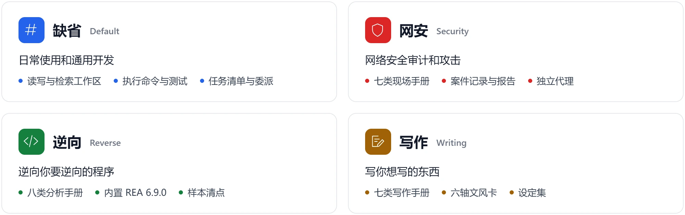
</picture>

四种模式共用内置的破甲提示词，区别在于带哪些工具、工作手册和资料。手册**按需加载**，用到哪本读哪本，不会一开始就塞满上下文。每种模式有自己的主题色，会话标题、侧栏色条和按钮颜色都会跟着变。

| 模式 | 主题色 | 擅长 | 专属资料 |
| --- | --- | --- | --- |
| 缺省 |  | 写代码、查问题、整理资料等日常任务 | 当前工作区 |
| 网安 |  | 应用审查、配置检查、问题复现与修复验证 | `.security/` 案件 |
| 逆向 |  | 程序、二进制、文件格式与协议分析 | `.reverse/` 案件 |
| 写作 |  | 小说、剧本与长文 | `story/` 文风与设定 |

新会话默认是**缺省**，发第一条消息前可以随意改；发出去之后模式锁定，避免中途换掉工具和手册。确实要换，在 *设置 → 模式* 里临时打开切换开关，重启后自动关闭。

<picture>
  <source media="(prefers-color-scheme: dark)" srcset="docs/assets/dshu/flow-mode-lock-dark.webp">
  
</picture>

### 缺省模式

日常使用和通用开发都用它：写代码、修 bug、查资料、处理文件。交给它一个需求，它会自己定位、修改和验证，最后说明改了哪些文件、跑了哪些检查，没跑的也会标出来。

- **工作区**：读取、搜索、编辑文件，运行构建和测试；只是问问题的话，也可以不选工作区。
- **工具**：网页检索、看图、浏览器与 MCP 工具、Office 文档的生成和转换。
- **长任务**：任务清单、计划、目标、子任务委派和工作流，按需加载技能。

缺省模式：定位搜索竞态并修复

### 网安模式

用于网络安全审计和攻击：应用审查、配置检查、问题复现、修复验证。手册给方法，案件记录留证据，需要时还能让目标流量走单独的代理。目标、证据和发现都写进案件文件，下次接着查，最后整理成报告。

- **七类现场手册**：交战流程、侦察、Web 攻击、网络利用、载荷实验、云与容器、报告，按调查阶段取用。
- **案件记录** ：每个案件一个 `.security/<案件>/case.json`，记下目标、证据、发现和备注，可以生成 Markdown 报告；审阅过的备注能存进记忆。
- **独立代理** ：默认关闭。打开后，网安会话访问目标的流量统一从你指定的代理出去，模型请求、登录、余额查询仍走原来的网络。流量可以筛选、查看详情、导出 JSON。
- **进入确认**：第一次在新会话里进入网安，会先请你读完责任说明，必要时输入一段声明。
- **目标保护** ：境内网站、指定目标和生产资源的拦截规则属于进阶功能，默认全关，需要时自己打开。

> [!WARNING]
>
> 网安模式会执行真实命令、访问真实目标。软件不会替你判断目标是否已获授权，请只在授权范围内使用。

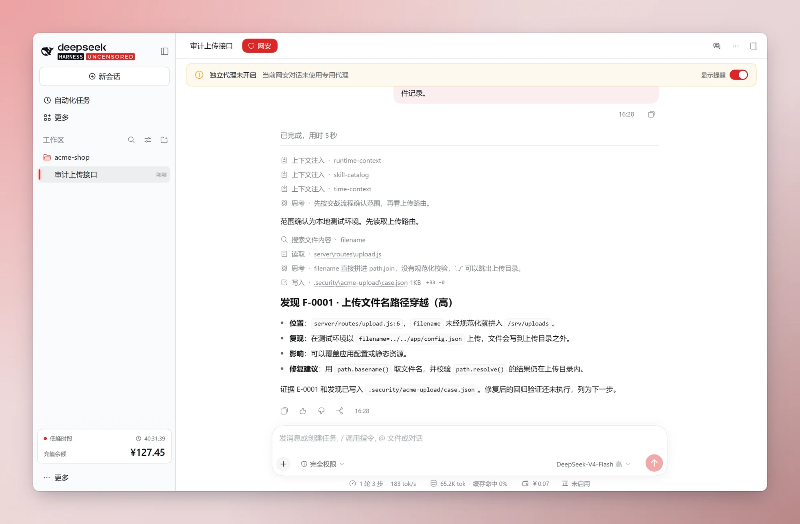

网安模式：确认上传接口的路径穿越并写入案件，顶部是独立代理未开启的提醒

<table>
<tr>
<td width="50%" valign="top"></td>
<td width="50%" valign="top"></td>
</tr>
<tr>
<td align="center">首次进入的确认</td>
<td align="center">案件与独立代理（设置 → 模式 → 网安）</td>
</tr>
</table>

独立代理与目标保护的覆盖范围

- **代理范围**：只在网安模式生效，覆盖受控网页抓取、遵守代理变量的命令与终端、桌面侧栏浏览器，以及以 `launch` 方式启动的 Playwright MCP、Chrome DevTools MCP 和 Stagehand。
- **流量正文**：没被拦截的 HTTPS 隧道只记录连接信息；[进阶目标保护](packages/guard/target-protection/README.zh.md)可以为指定工具开启 HTTP/1.1 检查并记录正文。
- **保护规则**：通过[可选保护配置](apps/cli/config/examples/target-protection.yml)接入，已覆盖的执行后端会在真正执行前拦截并留下审计记录。
- **尚未覆盖**：入站隔离、其他协议和部分远端资源还在做，开关打开不代表这些场景已经受保护。

### 逆向模式

逆向你要逆向的程序：二进制、文件格式、协议都行。结论要落到**地址、偏移或运行观察**上，推测和已验证的内容分开写，没确认的记进案件，下次接着来。

- **八类分析手册**：初筛、静态、动态、协议、补丁与注册机、移动端、恶意样本、案件簿。
- **内置 REA 6.9.0**：装好就有，不用另装。每个逆向会话独占一个分析进程，自带 JavaScript 分析和 Frida 绑定；Ghidra、IDA、Hopper 等引擎按需接入。
- **样本清点**：只读样本字节，算出 SHA-256、格式、熵和可打印字符串，不执行样本。
- **分析案件** ：`.reverse/<案件>/case.json` 记下样本、证据、发现和待验证的假设。

逆向模式：还原固件头布局并写出解码器

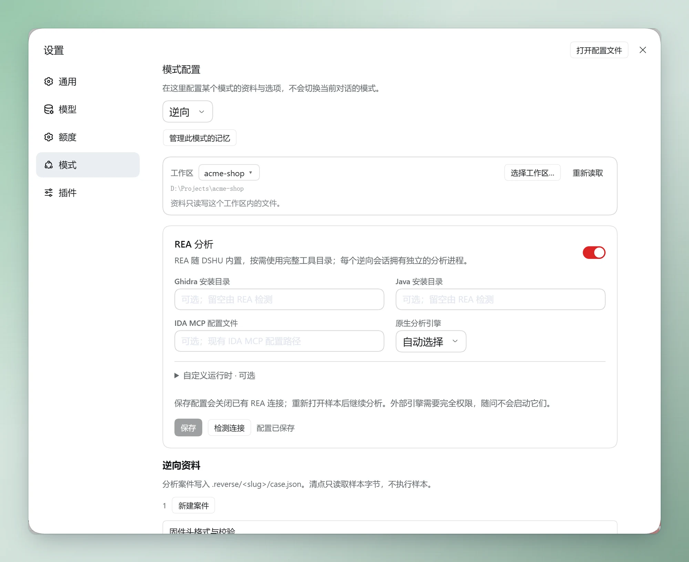

REA 与逆向资料（设置 → 模式 → 逆向）

### 写作模式

写你想写的东西：小说、剧本、长文。人物、设定和文风卡放在 `story/` 下，只有勾选的资料会发给模型；续写、修订、规划章节都以它们为准，正文和修改意见分开给。

- **七类写作手册**：写作基本功、声音、场景、黑暗素材、连续性、文风参考、长篇结构。
- **文风卡**：用措辞、句法、节奏、意象、对白、结构六条轴描述一种文风，再补上标志性手法、绝不会做的事和一段校准样例。
- **设定集**：`story/bible/` 放人物、世界、时间线和已经定下的事实，`story/style/` 放文风卡。
- **专注写作**：不挂载终端和代码执行工具。

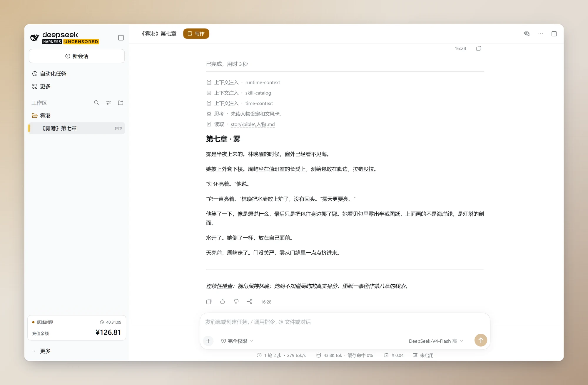

写作模式：按人物设定续写第七章，连续性检查附在正文之后

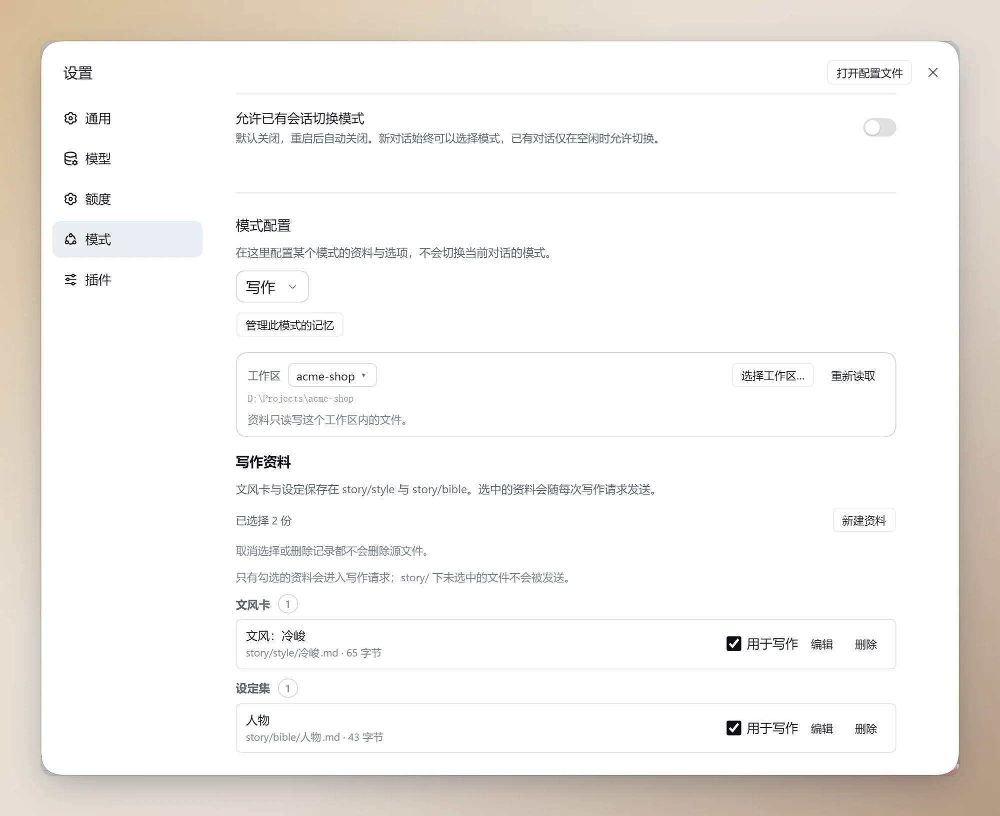

写作资料：勾选“用于写作”的才会发给模型

### 模式说明与设置

每种模式都附有说明，分“模式说明”和“如何使用”两页，后者有可以直接复制的示例任务。*设置 → 模式* 集中管理四种模式的说明、资料和切换开关。

查看四种模式的说明弹窗与模式设置页

<table>
<tr>
<td width="50%"></td>
<td width="50%">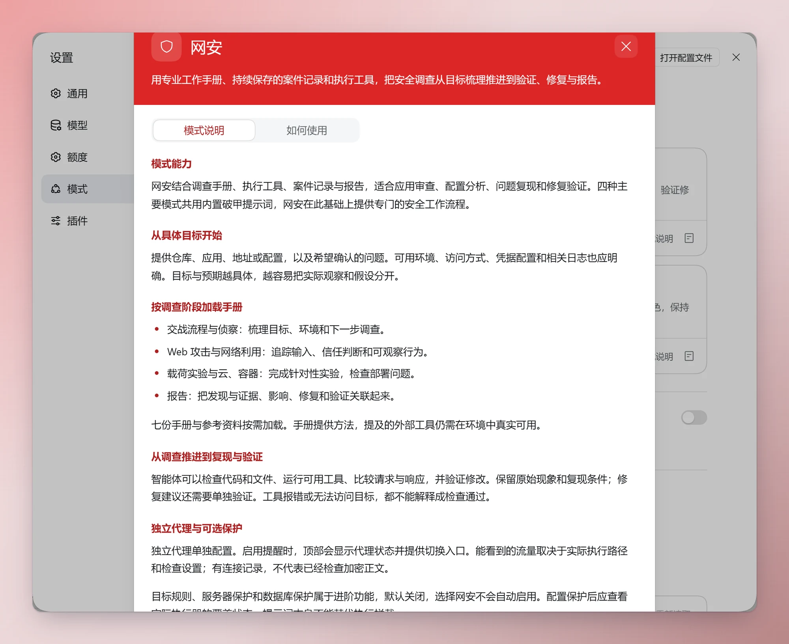</td>
</tr>
<tr>
<td width="50%">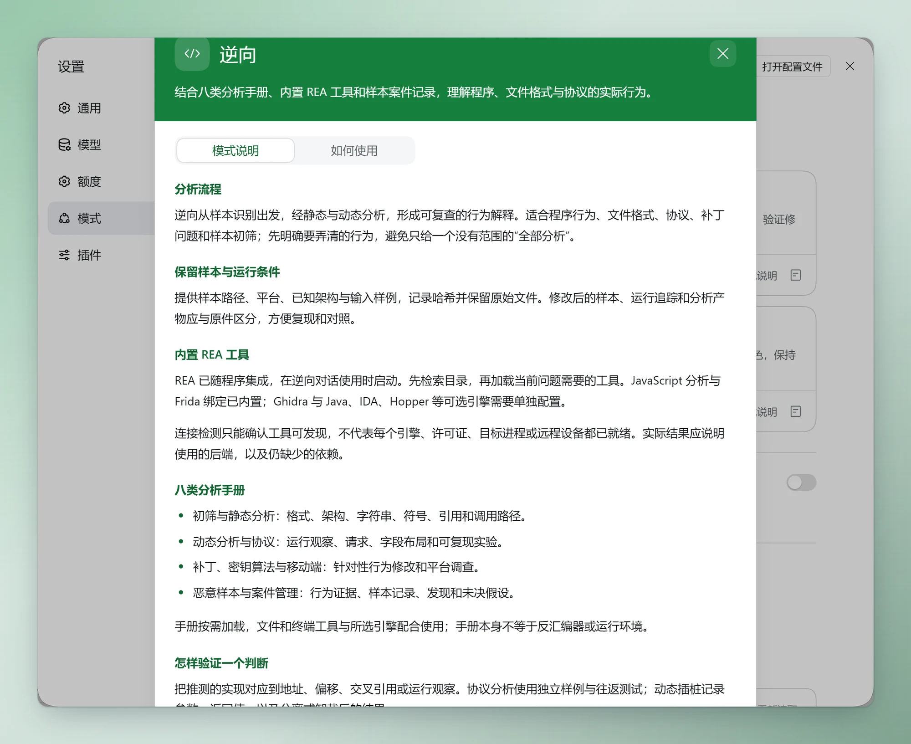</td>
<td width="50%">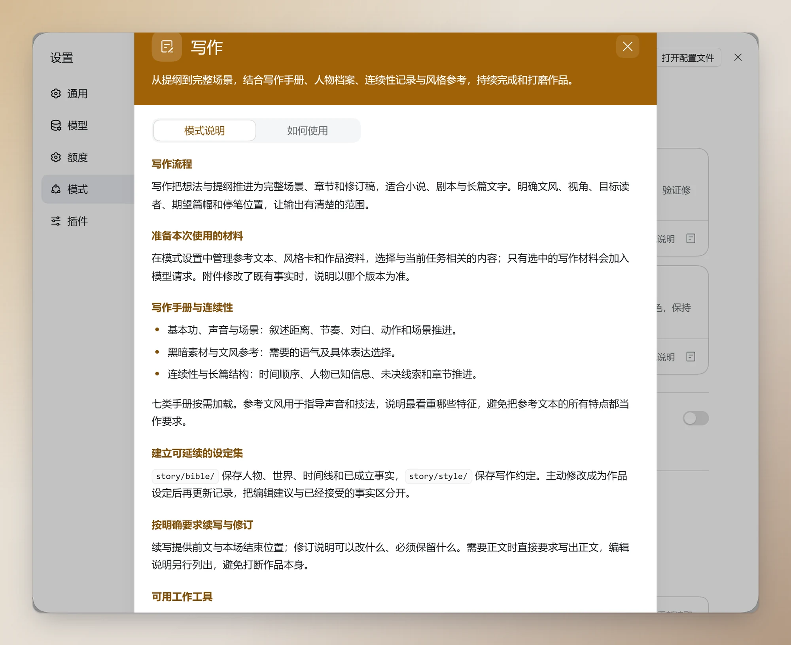</td>
</tr>
</table>

## 通用增强

### 旁问与随问

主线在跑任务时，有问题也不用等它停下来。旁问和随问都不会打断主线，也不会在侧栏多出新会话。

<picture>
  <source media="(prefers-color-scheme: dark)" srcset="docs/assets/dshu/flow-asides-dark.webp">
  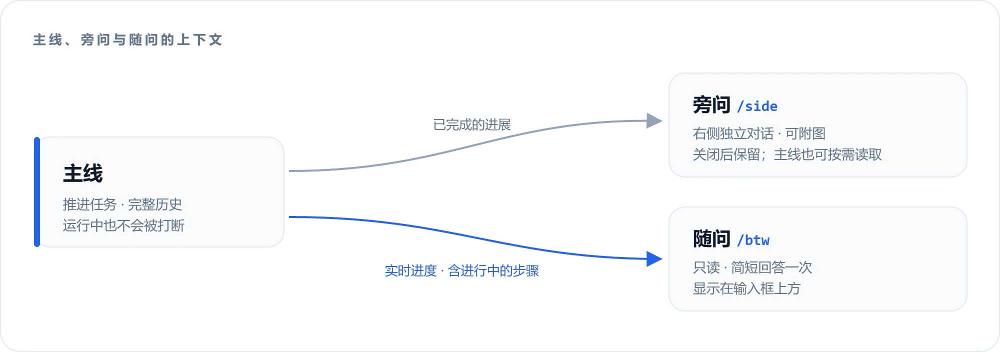
</picture>

| | 旁问 `/side` | 随问 `/btw` |
| --- | --- | --- |
| 适合 | 想多聊几句：讨论方案、追问细节、附图提问 | 只问一句：进度如何、这个报错什么意思 |
| 能看到主线的 | 已经完成的进展 | 实时进度，连正在跑的那一步也算 |
| 权限 | 和主线一致 | 只读，不改文件、不跑命令 |
| 去哪儿看 | 右侧标签页，关掉再开还在 | 输入框上方的一张小卡片 |

#### 旁问 /side

在右侧开一个独立对话，接着主线的上下文聊。每次提问前会同步主线**已完成**的进展；旁问自己的记录单独保存，关掉标签再打开还在，主线需要时也能读取。可以附图。

想从头开始，在旁问里发 `/clear`；也可以在 *设置 → 通用* 打开“旁问关闭后自动清除上下文”，关掉标签就清空。

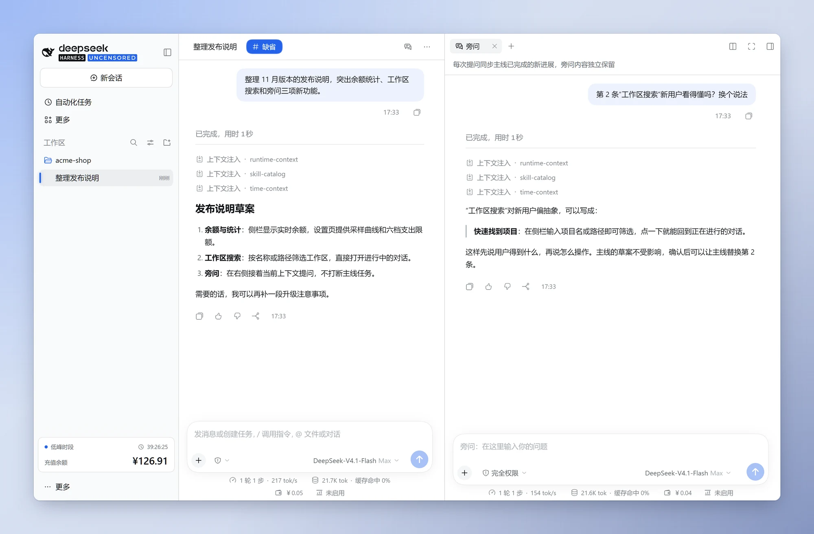

主线写好草案，旁问里讨论其中一条的写法

> [!NOTE]
>
> 旁问里商量好的事，主线不会自动去做。定下来之后，回主输入框说一声。

#### 随问 /btw

随问是给**任务运行途中**准备的。主线还在跑，想知道它做到哪了，发一句 `/btw 进度如何` 就行，这也是最常用的用法。随问读取主线的实时状态：当前步骤、任务清单进度、刚调用的工具，然后给一段简短回答，主线照常运行。

随问只有只读权限，回答默认不超过 512 token，思考等级默认 *低*。每次 `/btw` 都是新的一问，新卡片替换旧卡片。

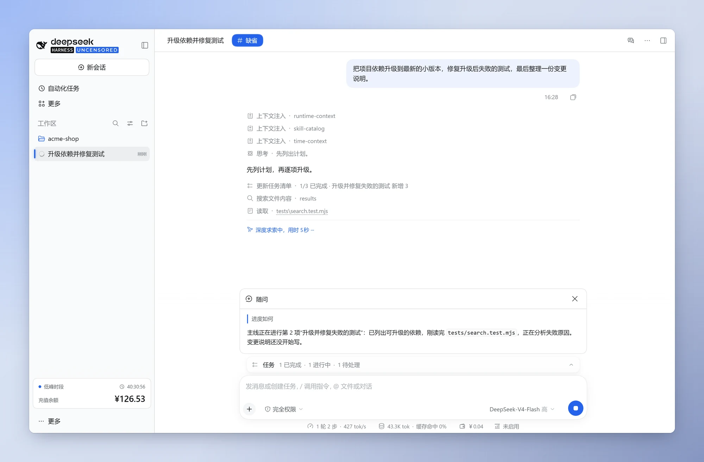

主线运行中，<code>/btw 进度如何</code> 报告当前做到哪一步

### 输入预测

打字停下来一会儿，输入框里会出现灰色的后半句，按 <kbd>Tab</kbd> 采用，不合适就接着打。主线、旁问和随问分别预测。它只管补全，不会替你发送。预测调用当前模型，会计费，不需要可以在 *设置 → 通用* 里关掉。

灰色部分是预测，按 Tab 填入

### 余额与额度限制

**余额**：侧栏常驻账户余额，并标出当前是官网的高峰还是低峰时段、离下次切换还有多久。*设置 → 额度* 里有本机采样的余额曲线，默认 15 秒采一次，悬停可以看到每个点的时间和金额；长时间没变化的区间会压缩，能放下两段完整虚线时用虚线标出。

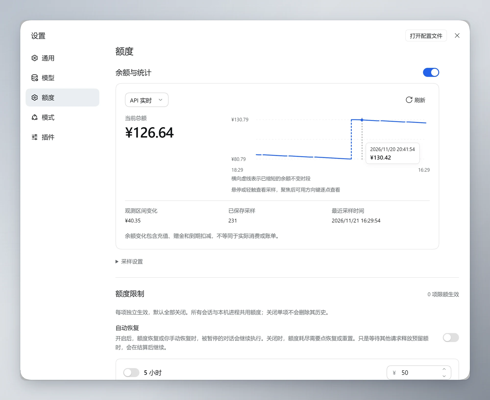

两天的余额曲线；横向虚线是被压缩的平稳时段

**额度限制**：如果你习惯使用各种 Coding Plan，有看额度百分比的癖好的话，DSHU 也提供了可选的额度限制功能，带来经典的 5h 和周限额，以及其它更多的限额选择。

- 15 分钟、1 小时、5 小时、1 天、7 天、30 天六档，各自开关、各自设金额，默认全关。
- 每次请求前先预留费用，结束后按实际结算，所以运行中的请求会暂时占用一部分额度。
- 任一启用的窗口额度不足，对话就会等待。打开 **自动恢复** 后，所有启用窗口都能容纳下一次请求时才继续。

<table>
<tr>
<td width="50%">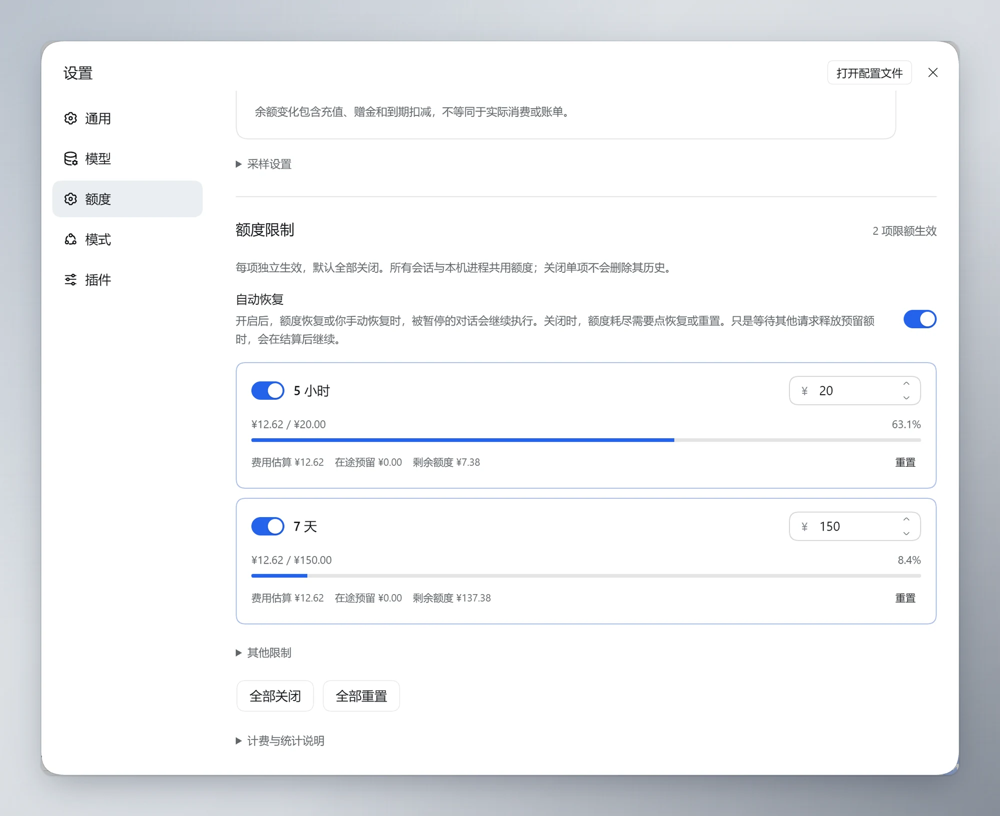</td>
<td width="50%"></td>
</tr>
<tr>
<td align="center">设置 → 额度</td>
<td align="center">额度用完，对话暂停并给出预计恢复时间</td>
</tr>
</table>

> [!CAUTION]
>
> “重置限额统计”只是把本地计数清零，不会充值，也不会退回提供方已经扣掉的钱。余额、费用和限额都是本地估算，*不是账单*。

### 跨对话记忆

 说过一次的事，不用每个新对话再说一遍。项目约定、个人偏好、做过的结论、小说设定都可以存成记忆，之后的对话需要时自动检索。每条记忆都有作用范围：全局、某个工作区、某种模式，或两者叠加，不会串到无关的对话里。

- 四种类型：偏好、项目事实、操作结论、写作设定。
- 可以搜索、筛选、编辑、停用、删除；网安案件里审阅过的备注也能直接存入。
- **自动提炼**默认关闭。打开后每轮对话结束会让模型整理一次，会计费。

设置 → 通用 → 管理记忆

## 其它小改进

| 改进 | 说明 |
| --- | --- |
| 底栏状态 | 输入框下方显示轮次与步数、生成速度、token 用量与缓存命中、本对话费用和限额进度 |
| 对话费用 | 点开底栏金额，看到这个对话的累计费用曲线；点开限额项，看各窗口用了多少 |
| 侧栏模式色条 | 每个会话左边一条模式色，另有运行中、置顶、等待审批等标记 |
| 会话管理 | 置顶与普通会话分区拖动排序；分叉会继承原会话的模式；归档随时找回 |
| 彻底删除 | 删除对话会先停下任务，再连同旁问、随问和子会话一起删掉，工作区文件不动 |
| 日出日落主题 | 默认按所在时区估算日出日落，白天浅色、晚上深色；也可固定浅色、深色或跟随系统 |
| 敏感操作确认 | 进入网安、切换已有会话的模式前要求确认，默认开启 |
| 关于与更新 | 关于页列出 DSHU 与 DSH 版本、源码节点、dsh-purge 与 REA 来源，可直接检查 GitHub 更新 |

查看侧栏、会话菜单、删除确认、外观与关于页

<table>
<tr>
<td width="50%">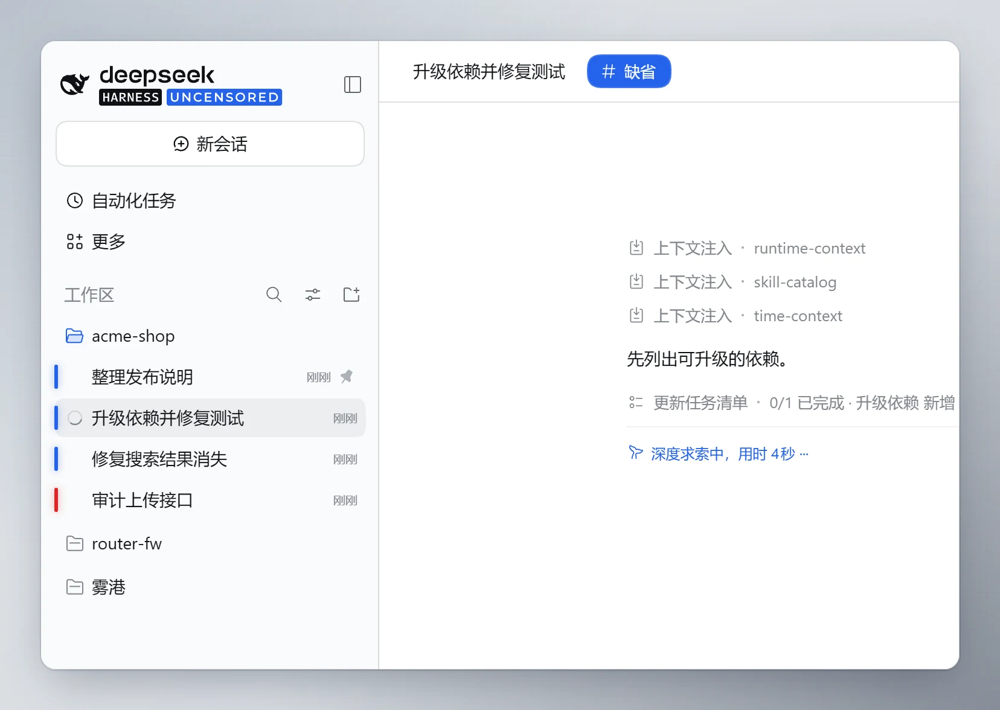</td>
<td width="50%"></td>
</tr>
<tr>
<td width="50%"></td>
<td width="50%">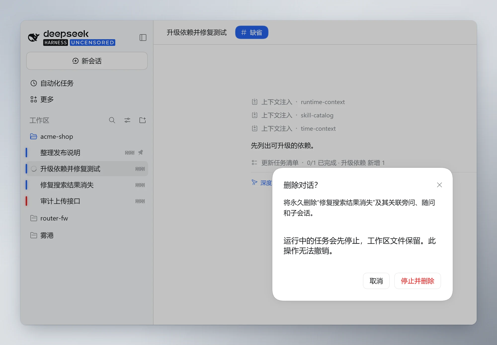</td>
</tr>
<tr>
<td width="50%">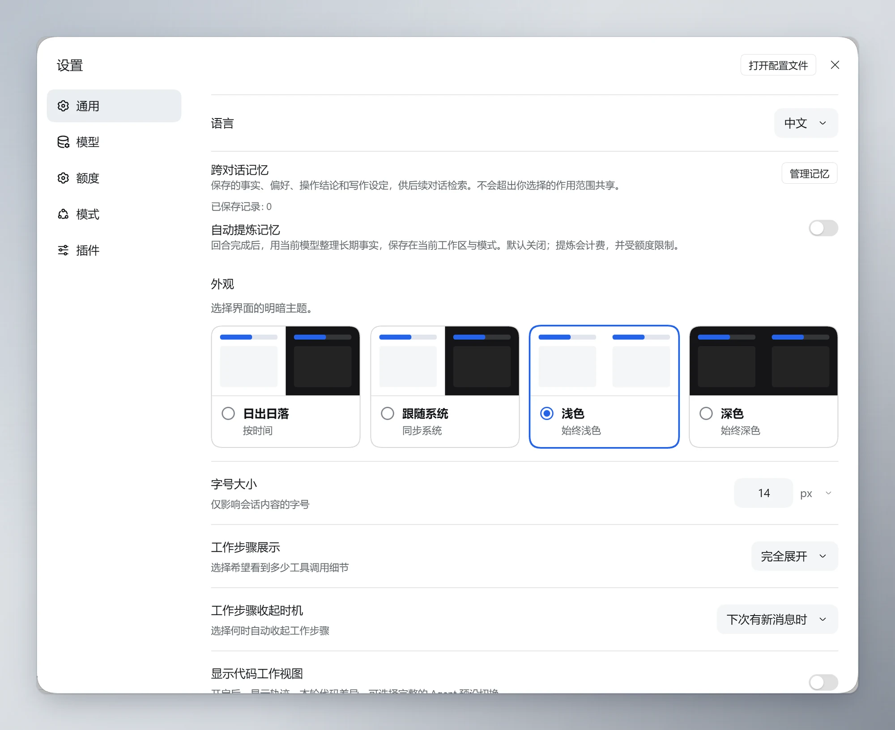</td>
<td width="50%"></td>
</tr>
</table>

## 安装与数据

| 项目 | 说明 |
| --- | --- |
| 下载 | [正式版 2026.11.23.0](https://github.com/Water-Run/deepseek-harness-uncensored/releases/tag/v2026.11.23.0)：Windows x64（exe）、Linux x64（deb / rpm）、Linux arm64（deb）、[macOS arm64（DMG 安装包）](https://github.com/Water-Run/deepseek-harness-uncensored/releases/download/v2026.11.23.0/DSHU-2026.11.23.0-mac-arm64.dmg) |
| 首次配置 | 设置 → 模型中填写提供方与凭据，详见[模型配置](docs/user/guide/providers.zh.md) |
| 版本号 | `YYYY.MM.DD.N`，末位是当天的构建序号，每天第一个构建为 `0`，可在关于页核对 |
| 数据目录 | 默认 `~/.dsh-uncensored`，可用环境变量 `DSH_UNCENSORED_HOME` 修改 |
| 与官方版并存 | 程序、配置、会话和更新渠道各自独立 |

> [!IMPORTANT]
>
> 更新前请先关闭 DSHU，备份数据目录和重要的工作区文件。正式签名、在线升级和自动回退还在验收中，进度见[开发清单](.agents/TODO.md)。

## 文档导航

| 文档 | 内容 |
| --- | --- |
| [使用手册](docs/user/guide/dshu.md) | 第一个任务、各模式用法、默认值、数据恢复、故障排查和功能入口速查 |
| [模型配置](docs/user/guide/providers.zh.md) | 模型提供方、凭据与自定义接口 |
| [模式资料](packages/client/ui-mode-materials/README.zh.md) · [REA 接入](packages/mcp/rea/README.zh.md) · [执行保护](packages/guard/target-protection/README.zh.md) | 专项功能的技术说明 |
| [开发清单](.agents/TODO.md) · [交付记录](.agents/HANDOFF.md) | 功能进度、验收状态与发布流程 |
| [反馈问题](https://github.com/Water-Run/deepseek-harness-uncensored/issues/new/choose) | 缺陷报告与功能建议 |

## 版本基线

| 组成 | 基线 |
| --- | --- |
| DSHU | 最新正式版 `2026.11.23.0` |
| DeepSeek Harness | 源码基于 [0.2.2-rc.5](https://github.com/deepseek-ai/deepseek-harness/releases/tag/dsh-v0.2.2-rc.5) |
| 破甲提示词 | dsh-purge Community [v1.7.20](https://github.com/kingcharleslzy-ai/dsh-purge/releases/tag/v1.7.20) |
| REA | [6.9.0 · d74549e495c5](https://github.com/morluto/rea/commit/d74549e495c58eb4a560279fd9f05508401ea0a0) |

## Credit

- **DeepSeek**：提供原始的 DeepSeek Harness 和鲸鱼轮廓，DSHU 图标在此基础上改为黑底。上游代码保留 [MIT 许可](LICENSES/deepseek-harness-MIT.txt)。
- **小杨（YuJunZhiXue）**：[dsh-purge](https://github.com/YuJunZhiXue/dsh-purge) 的原作者，提供破甲提示词的初代实现。DSHU 沿用其 MIT 历史版本并保留[原许可](LICENSES/dsh-purge-MIT.txt)。
- **kingcharleslzy-ai 与 dsh-purge 社区贡献者**：[dsh-purge Community](https://github.com/kingcharleslzy-ai/dsh-purge) 接手维护破甲提示词，DSHU 采用其 [v1.7.20](https://github.com/kingcharleslzy-ai/dsh-purge/releases/tag/v1.7.20) 的正文与机制，保留同一份 MIT 许可。关于页记录该发行版的对照提交及其时间。
- **JeffKeeping**：[dsh-purge-plus](https://github.com/JeffKeeping/dsh-purge-plus) 提供历史提示词的补充参考。
- **morluto**：维护 [REA](https://github.com/morluto/rea)。DSHU 内置版本保留其 MIT 许可和第三方声明。
- **其他组件**：可选保护使用 [DB-IP Lite](https://db-ip.com/db/download/ip-to-country-lite)（[CC BY 4.0](https://creativecommons.org/licenses/by/4.0/)）以及 [QuickJS](https://bellard.org/quickjs/) / [quickjs-emscripten](https://github.com/justjake/quickjs-emscripten)（[MIT 声明](LICENSES/quickjs-wasm-MIT.txt)）。GitHub 标志来自 [Octicons](https://github.com/primer/octicons)，保留 [MIT 许可](packages/client/ui-settings-account/GITHUB-MARK-LICENSE.txt)。

DSHU 以 [GPL-3.0-or-later](LICENSE) 发布，上游和第三方组件保留各自的许可与署名。

## 友链

- [LINUX DO](https://linux.do/) — 技术交流社区
