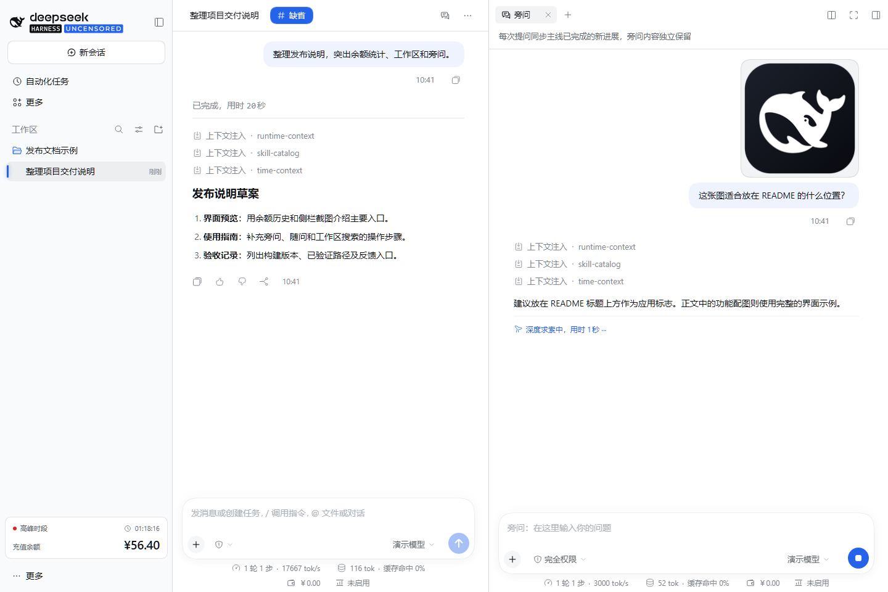
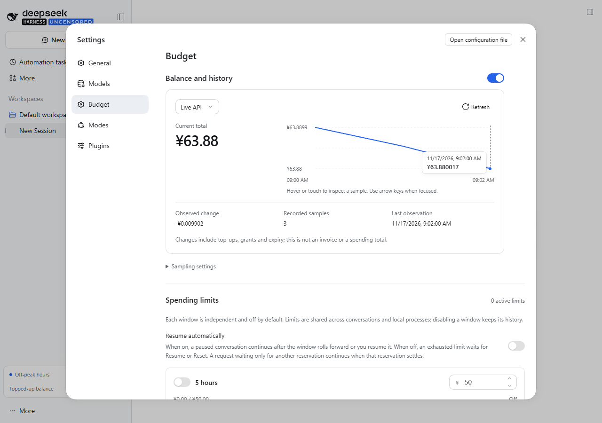

  
  <h1>DeepSeek Harness Uncensored</h1>
  
<b>更自由的探索未至之境</b>

  
WaterRun · Windows / Linux Desktop · 源码基于 DeepSeek Harness 0.2.2-rc.5

**DeepSeek Harness Uncensored（DSHU）** 是基于 DeepSeek Harness 的桌面工作台。它集成破甲文本，为开发、网安、逆向和写作提供各自的模式，并加入旁问、随问、额度控制、跨对话记忆和输入预测。DSHU 与官方 DSH 可以并存，各自使用独立的程序目录、配置、会话和更新渠道。

[四种模式](#四种模式) · [其它增强](#其它增强) · [文档导航](#文档导航) · [Credit](#credit)

## 四种模式

新对话默认使用缺省模式，发送前可切换。已有会话默认锁定模式。

### 缺省 · 开发与日常任务

用于修复程序、理解项目和整理资料。

- **文件与命令**　读取和修改工作区文件，运行构建、测试及日常命令。
- **检索与协作**　查找资料，使用工作流与协作推进多步任务。
- **交付与验证**　完成修改后检查正常与异常输入，记录验证结果和仍待确认的事项。

### 网安 · 调查与证据

用于安全审计、修复验证和证据整理。

- **案件记录**　在 `.security/` 保存目标、证据和待确认问题，便于后续核查并整理报告。经审阅的案件备注可保存为限定范围的记忆。
- **开始前确认**　首次进入新的网安会话会显示责任确认与当前保护状态。
- **独立代理**　在模式配置中启用网安专用代理，查看和导出脱敏的流量记录。
- **目标保护**　境内域名、手动目标与生产资源保护默认关闭，按需配置并查看实际覆盖。

独立代理与可选目标保护的覆盖范围

**独立代理**

- **覆盖范围**　独立代理仅用于网安模式，覆盖受控抓取、遵守代理变量的命令与终端、桌面侧栏及以 `launch` 方式运行的 Playwright MCP、Chrome DevTools MCP 和 Stagehand。
- **流量记录**　不透明 HTTPS 隧道记录连接元数据。[进阶目标保护](packages/guard/target-protection/README.zh.md)可为指定工具启用 HTTP/1.1 检查并脱敏记录正文。
- **会话信任**　桌面侧栏和三个启动型浏览器提供方使用各自的会话信任，命令行客户端可显式使用监听器的公开证书。
- **顶部提醒**　网安可启用未开代理的顶部提醒。

**可选目标保护**

- **规则与默认值**　境内、手动目标及生产资源规则由[可选保护配置](apps/cli/config/examples/target-protection.yml)接入，默认关闭。
- **拦截与审计**　已覆盖的后端支持真实执行拦截与审计，设置页分别显示 HTTP、本机文件、命令/终端、SSH 和数据库的覆盖。
- **连接与权限**　SSH 显示已验证连接，数据库显示配置数，连接和权限在执行时核验。
- **开发中**　原生入站隔离、其他协议和部分远端资源仍在开发。

### 逆向 · 从样本到行为解释

用于理解程序、二进制和协议的行为，并保留可复核的证据。

- **样本分析**　记录样本哈希与架构，结合静态与动态分析检查文件格式、符号和调用关系。
- **内置 REA**　随 DSHU 提供 REA 6.9.0，无需另装。Ghidra、Java、IDA 等可选引擎按需配置，各引擎状态独立查看。[REA 接入说明](packages/mcp/rea/README.zh.md)
- **案件材料**　在 `.reverse/` 保存笔记、证据和待验证结论，后续会话可沿用同一份材料。

### 写作 · 文风与长篇延续

用于小说、剧本和长文的续写、修订与一致性检查。

- **参考文风**　可选参考资料和六轴风格卡约定表达方式。
- **设定集**　使用 `story/bible/` 管理人物、世界和时间线，续写时检查视角、人物关系与设定冲突。
- **资料选择**　选中的资料进入模型请求。写作模式不挂载终端和代码执行工具。[写作资料管理](packages/client/ui-mode-materials/README.zh.md)

## 其它增强

### 旁问和随问

在右侧围绕主线追问，也可以在当前会话里临时问一句。

- **旁问**　输入 `/side 问题` 可打开旁问并发送。单独输入 `/side` 可打开或重开。旁问参考主线最新进展，历史独立保存并支持传图。
- **清理上下文**　`/clear` 只在旁问中可用。关闭旁问默认保留历史，可在设置里开启关闭时清理。
- **随问**　输入 `/btw 问题`，获得一条留在主会话里的简短回答。

### 余额和额度

查看账户余额的变化，并为模型费用设置独立的滚动限额。

- **余额曲线**　默认每 15 秒采样，最短 3 秒。可立即刷新，也可悬停查看具体时点和金额。长时间平稳的区间用虚线缩短。
- **六档限额**　默认全部关闭，各窗口可独立调整、启停和重置。设置优先展示 5 小时和 7 天。
- **暂停与恢复**　限额触发时显示暂停横幅，提供可确定的恢复时间和快捷重置。开启自动恢复后，额度可用时可继续对话。
- **底栏用量**　点开本对话费用可看累计曲线，点开限额状态可看已启用窗口的进度。

### 记忆和输入预测

把值得保留的信息留给后续会话，并在输入时接受所需的草稿建议。

- **跨对话记忆**　按范围检索、编辑、禁用或删除结构化记忆。自动提炼默认关闭。
- **输入预测**　默认开启。主线、旁问和随问分别提供建议，按 `Tab` 填入。
- **模型用量**　启用后的预测和提炼会调用当前模型，按提供方规则计入用量。

### 会话和外观

按工作区整理对话，用模式配色识别任务。

- **工作区**　按名称或路径搜索工作区，从项目行打开进行中的会话，也可选择不在工作区工作。
- **会话操作**　支持归档、置顶、分叉和删除。任务运行中仍可插话发送。
- **主题与布局**　模式主题色随会话变化，侧栏色条标识模式。界面可选浅色、深色、跟随系统或日出日落。

## 文档导航

- [使用手册](docs/user/guide/dshu.zh.md)　首次配置、常用流程、设置和数据恢复。
- [细节功能索引](docs/user/guide/dshu-features.zh.md)　查找会话删除、归档、置顶、分叉和工作区搜索等操作。
- [模型配置](docs/user/guide/providers.zh.md)　模型提供方、凭据和自定义接口。
- [预发布下载](https://github.com/Water-Run/deepseek-harness-uncensored/releases/tag/v2026.11.17.5)　版本 `2026.11.17.5` 提供 Windows x64 与 Linux x64 检查包。
- [Windows 首发交接](.agents/requirements/windows-x64-first-release.md)　候选验收、回退与手动发布流程。
- [开发清单](.agents/TODO.md) · [交付记录](.agents/HANDOFF.md) · [反馈问题](https://github.com/Water-Run/deepseek-harness-uncensored/issues/new/choose)
- [English user guide](docs/user/guide/dshu.md)

## Credit

- **DeepSeek** 提供原始 Harness 和鲸鱼轮廓。DSHU 使用黑底图标，保留上游的 MIT 许可。[DeepSeek Harness 0.2.2-rc.5](https://github.com/deepseek-ai/deepseek-harness/releases/tag/dsh-v0.2.2-rc.5) · [MIT 许可](LICENSES/deepseek-harness-MIT.txt)
- **小杨（YuJunZhiXue）** 的 [dsh-purge](https://github.com/YuJunZhiXue/dsh-purge) 提供破甲文本。沿用 [MIT 历史版本 e1d8e590](https://github.com/Water-Run/dsh-purge/tree/e1d8e59087857fa86d0ef2bb9878800274b13a29) 与[原许可](LICENSES/dsh-purge-MIT.txt)。同时感谢 **JeffKeeping** 的 [dsh-purge-plus](https://github.com/JeffKeeping/dsh-purge-plus)。关于页记录 [Water-Run/dsh-purge fork 对照提交 19082c2b9788](https://github.com/Water-Run/dsh-purge/commit/19082c2b9788039fa7f8888c4a69086f43adc1ff) 及其时间。
- **morluto** 维护 [REA](https://github.com/morluto/rea)。内置版本为 [6.9.0 · d74549e495c5](https://github.com/morluto/rea/commit/d74549e495c58eb4a560279fd9f05508401ea0a0)，保留 MIT 许可和第三方声明。
- 可选保护使用 [DB-IP Lite](https://db-ip.com/db/download/ip-to-country-lite)（[CC BY 4.0](https://creativecommons.org/licenses/by/4.0/)）和 [QuickJS](https://bellard.org/quickjs/) / [quickjs-emscripten](https://github.com/justjake/quickjs-emscripten)（[MIT 声明](LICENSES/quickjs-wasm-MIT.txt)）。GitHub 标志来自 [Octicons](https://github.com/primer/octicons)，保留 [MIT 许可](packages/client/ui-settings-account/GITHUB-MARK-LICENSE.txt)。

DSHU 采用 [GPL-3.0-or-later](LICENSE)。上游和第三方组件保留各自的许可与署名。
