<div align="center">


# DeepSeek Harness Uncensored

**更自由的探索未至之境**

[](https://github.com/Water-Run/deepseek-harness-uncensored/releases/tag/v2026.11.17.5) [](#安装与数据) [](https://github.com/deepseek-ai/deepseek-harness/releases/tag/dsh-v0.2.2-rc.5) [](LICENSE)

[四种模式](#四种模式) · [旁问与随问](#旁问与随问) · [余额与限额](#余额与支出限额) · [记忆与预测](#跨对话记忆) · [使用手册](docs/user/guide/dshu.md) · [下载](https://github.com/Water-Run/deepseek-harness-uncensored/releases/tag/v2026.11.17.5)

</div>

<picture>
  <source media="(prefers-color-scheme: dark)" srcset="docs/assets/dshu/hero-dark.webp">
  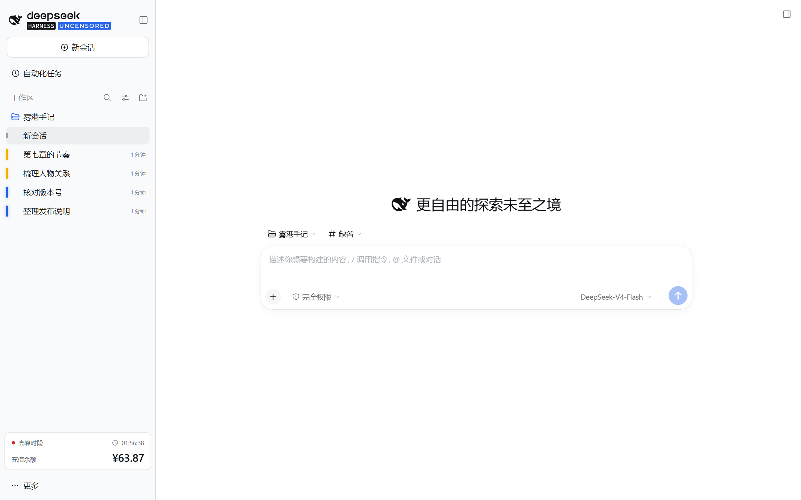
</picture>

**DSHU** 是基于 DeepSeek Harness 的桌面智能体工作台。它内置破甲提示词，为开发、网络安全、逆向工程和创作写作分别准备了一种模式，并补上了日常使用中最常用的一组能力：不打断主线的旁问和随问、账户余额曲线与六档支出限额、跨对话记忆和输入预测。

> [!NOTE]
>
> DSHU 使用独立的程序目录、配置、会话和更新渠道，可以与官方 DeepSeek Harness 同时安装，两者互不读写对方的数据。

## 一图看懂

<table>
<tr>
<td width="50%" valign="top"><a href="#缺省模式"></a><br><b>缺省</b>：读写文件、执行命令、检索资料，把多步任务拆开推进。</td>
<td width="50%" valign="top"><a href="#网安模式"></a><br><b>网安</b>：七类现场手册、案件记录、独立代理与进入确认。</td>
</tr>
<tr>
<td width="50%" valign="top"><a href="#逆向模式"></a><br><b>逆向</b>：八类分析手册、内置 REA、样本清点与分析案件。</td>
<td width="50%" valign="top"><a href="#写作模式"></a><br><b>写作</b>：七类写作手册、文风卡、设定集与连续性检查。</td>
</tr>
</table>

| 通用增强 | 一句话说明 | 入口 |
| --- | --- | --- |
| [旁问](#旁问-side) | 在右侧接着主线讨论，主线照常运行 | `/side 问题` |
| [随问](#随问-btw) | 任务进行中问一句“进度如何”，读取实时进度后简短回答 | `/btw 问题` |
| [输入预测](#输入预测) | 停顿后给出灰色续写建议，<kbd>Tab</kbd> 填入但不发送 | 默认开启 |
| [余额与统计](#余额与支出限额) | 侧栏实时余额、高低峰时段和本机采样曲线 | 侧栏余额卡片 |
| [支出限额](#余额与支出限额) | 15 分钟到 30 天六档窗口，超额自动暂停 | 设置 → 额度 |
| [跨对话记忆](#跨对话记忆) | 按工作区和模式保存长期事实，后续对话检索 | 设置 → 通用 → 管理记忆 |
| [会话与工作区](#会话与工作区) | 模式色条、置顶、分叉、归档和彻底删除 | 侧栏 |
| [外观与关于](#外观关于与更新) | 日出日落主题、模式主题色、版本来源与更新检查 | 设置 → 通用 · 账号菜单 |

## 四种模式

四种模式共用内置破甲提示词，区别在于挂载的工具、按需加载的工作手册和各自的资料目录。打开一个会话，顶部的模式标记、侧栏色条、发送按钮和选中色都会换成对应的主题色。

| 模式 | 主题色 | 适合 | 专属资料 | 不挂载 |
| --- | --- | --- | --- | --- |
| 缺省 | 蓝 `#2563EB` | 开发、排错、资料整理、日常任务 | 当前工作区 | — |
| 网安 | 红 `#DC2626` | 应用审查、配置分析、问题复现与修复验证 | `.security/<案件>/case.json` | — |
| 逆向 | 绿 `#15803D` | 程序、二进制、文件格式与协议分析 | `.reverse/<案件>/case.json` | — |
| 写作 | 金 `#A16207` | 小说、剧本与长文 | `story/style/`、`story/bible/` | 终端、代码执行 |

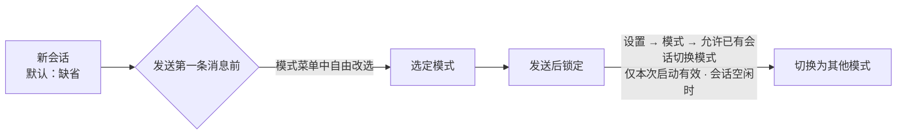

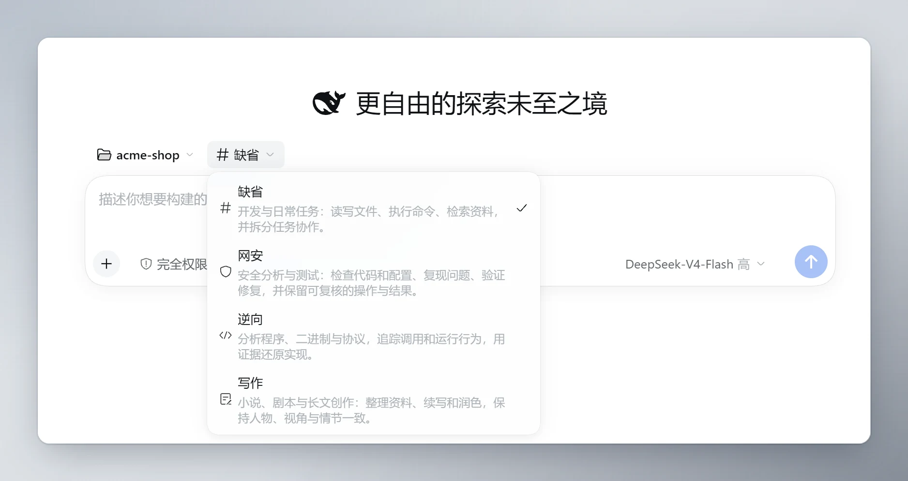

### 缺省模式

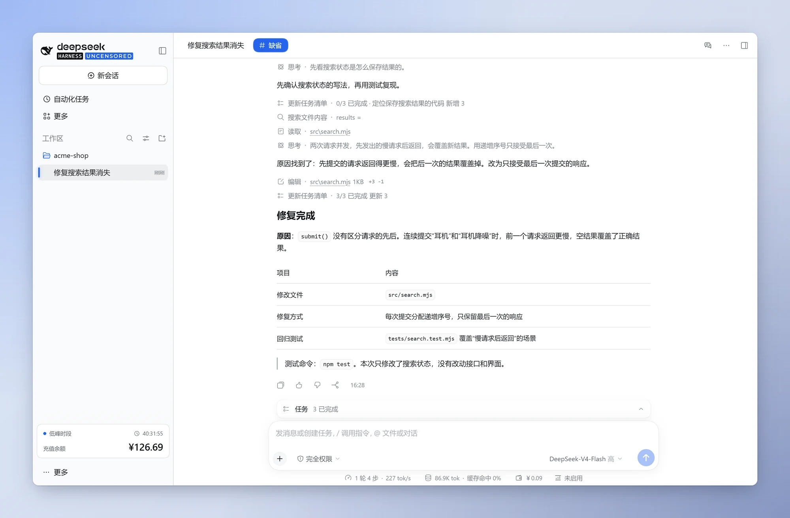

截图中的任务是“搜索框连续提交两次后结果消失”。智能体先用任务清单拆出三步，搜索并读取 `src/search.mjs`，在思考中确认是慢请求覆盖了新结果，随后直接修改文件，最后用表格交代修改文件、修复方式和回归测试。工作步骤（上下文注入、思考、搜索、读取、编辑、任务清单）逐行展开，点开即可查看参数和结果。

| 能力 | 说明 |
| --- | --- |
| 工作区 | 读取、搜索和编辑文件，运行构建、测试和项目工具；一般问答可以选择“不在工作区工作” |
| 资料与工具 | 检索网页、查看图片、使用已配置的浏览器或 MCP 工具，创建和转换 Office 文件 |
| 长任务 | 任务清单、计划、目标、子任务委派和工作流，按需加载技能 |
| 交付核对 | 修改完成后报告实际执行过的检查，把未运行的验证和剩余问题分开说明 |

> [!TIP]
>
> 写清“输入、期望结果和怎样算完成”。例如：*调查搜索连续提交两次后结果消失的原因。先复现并解释原因，再完成必要的修复，运行相关测试，保留已有用户数据。*

<details>
<summary>模式说明弹窗（设置 → 模式 → 模式说明）</summary>

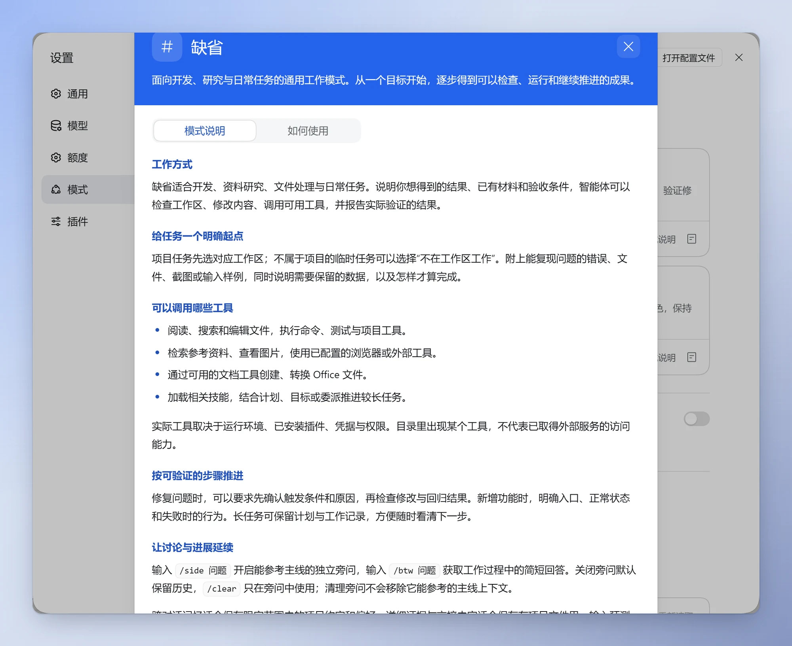

每种模式都有“模式说明”和“如何使用”两个标签：前者讲能力与工作方式，后者给出可直接复制的示例任务、准备材料和检查交付的要点。阅读说明不会切换当前会话的模式。

</details>

### 网安模式


截图中，智能体按“交战流程”确认范围后读取上传路由，发现 `filename` 未经规范化就拼进上传目录，随后把目标、证据和发现写入 `.security/acme-upload/case.json`，并把“修复后的回归验证尚未执行”单独列为下一步。顶部黄色横幅是独立代理未开启的提醒，可以在横幅上直接关闭提醒。

**七类现场手册**按调查阶段加载，目录摘要始终可见，正文在需要时才读入上下文：

| 阶段 | 手册 |
| --- | --- |
| 规划 | 交战流程、侦察 |
| 测试 | Web 攻击、网络利用、载荷实验、云与容器 |
| 交付 | 报告：把发现与证据、影响、修复和验证关联起来 |

<table>
<tr>
<td width="50%" valign="top">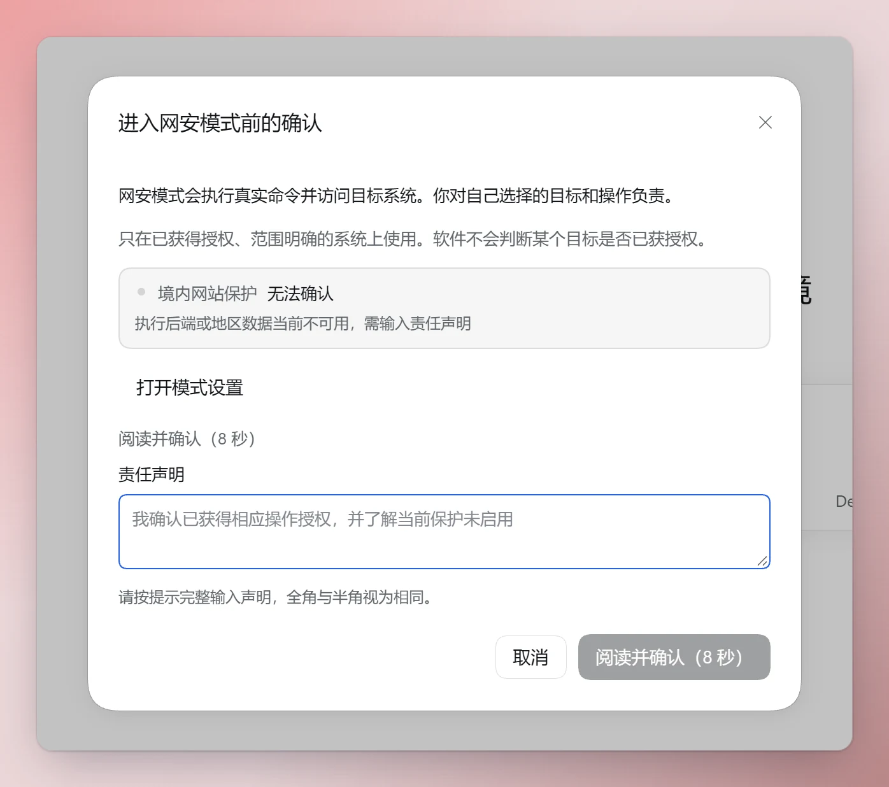</td>
<td width="50%" valign="top">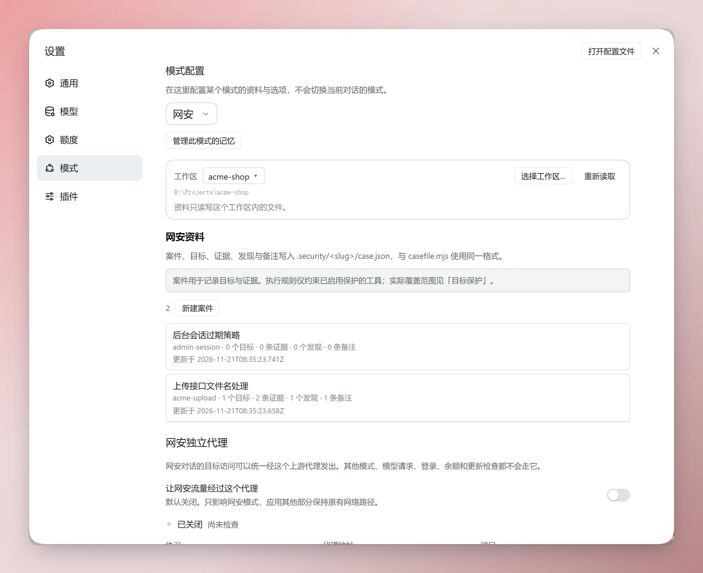</td>
</tr>
<tr>
<td valign="top"><b>首次进入确认</b>：第一次在新会话中进入网安时，先阅读责任说明和当前保护状态。保护未启用或无法确认时，需要按提示完整输入责任声明（全角与半角视为相同），倒计时结束后才能确认。</td>
<td valign="top"><b>案件记录</b>：设置 → 模式 → 模式配置 → 网安。每个案件保存目标、证据、发现与备注，可生成 Markdown 报告；审阅过的备注可以“存入记忆”，默认限定在当前工作区和网安模式。</td>
</tr>
</table>

- **独立代理**：默认关闭。开启后，网安对话的目标访问统一经你配置的 HTTP/HTTPS 上游代理发出；模型请求、登录、余额和更新检查不走它。密码保存在凭据系统中，不写进普通设置和流量记录。
- **流量记录**：可暂停采集、按方法/目标/工具筛选、查看请求与响应详情、导出脱敏后的 JSON。未被拦截的 HTTPS 隧道只记录连接元数据，没有正文。
- **目标保护**：境内网站、手动目标与生产资源规则属于进阶功能，默认全部关闭，选择网安不会自动开启。启用后，设置页按执行器列出实际覆盖范围。

> [!WARNING]
>
> 网安模式会执行真实命令并访问目标系统，软件不会判断某个目标是否已获授权。只在已获得授权、范围明确的系统上使用，并对自己选择的目标和操作负责。

<details>
<summary>独立代理与目标保护的覆盖范围</summary>

- **代理范围**：仅在网安模式中生效，覆盖受控网页抓取、遵守代理变量的命令与终端、桌面侧栏浏览器，以及以 `launch` 方式运行的 Playwright MCP、Chrome DevTools MCP 和 Stagehand。
- **流量正文**：[进阶目标保护](packages/guard/target-protection/README.zh.md)可以为指定工具启用 HTTP/1.1 检查，并脱敏记录正文。
- **证书信任**：桌面侧栏和三个启动型浏览器各自管理会话信任；命令行客户端可以显式信任监听器的公开证书。
- **保护规则**：通过[可选保护配置](apps/cli/config/examples/target-protection.yml)接入，已覆盖的执行后端会在真实执行前拦截并留下审计记录；SSH 显示已验证的连接，数据库显示已配置的数量。
- **尚未覆盖**：原生入站隔离、其他协议和部分远端资源仍在开发中，开关本身不代表这些场景已受保护。

</details>

<details>
<summary>网安模式说明弹窗</summary>


</details>

### 逆向模式

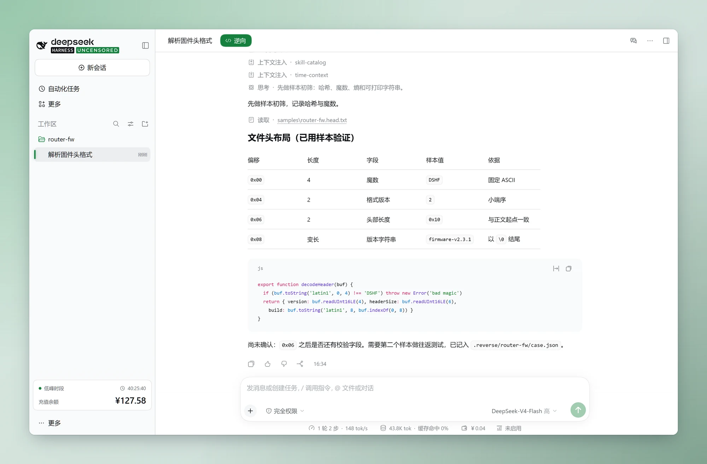

截图中，智能体先做样本初筛，再把文件头整理成“偏移 / 长度 / 字段 / 样本值 / 依据”五列表格，写出独立的解码函数，最后把尚未确认的校验字段和需要的第二个样本记入 `.reverse/router-fw/case.json`。推断和已用样本验证的结论分开表述。

**八类分析手册**：初筛、静态分析、动态分析、协议、补丁与注册机、移动端、恶意样本、案件簿。

<table>
<tr>
<td width="50%" valign="top"></td>
<td width="50%" valign="top">

**内置 REA 6.9.0**：随 DSHU 提供，无需另装。每个逆向会话拥有独立的分析进程，按需使用完整工具目录；JavaScript 分析与 Frida 绑定已内置。

**可选引擎**：Ghidra（含 Java）、IDA MCP 配置、Hopper，留空时由 REA 在调用时检测。“检测连接”只确认 REA 可用，引擎版本和依赖在实际打开样本时检查。

**样本清点**：只读取文件字节，计算 SHA-256、容器格式、熵和可打印字符串，不执行、不加载样本。

</td>
</tr>
</table>

<details>
<summary>逆向模式说明弹窗</summary>


</details>

### 写作模式


截图中，智能体先读取 `story/bible/人物.md`，再按选定文风续写《雾港》第七章，正文结束后用一行斜体单独交代连续性检查：视角保持林晚、她尚不知道访客身份、图纸作为下一章线索。编辑说明和正文分开，不打断作品本身。

**七类写作手册**：写作基本功、声音、场景、黑暗素材、连续性、文风参考、长篇结构。

**文风卡**用六条轴描述一种文风，另附三项补充，避免把参考文本的所有特点都当成要求：

| 轴 | 记录什么 |
| --- | --- |
| 措辞 | 用词的雅俗、具体程度和偏好词汇 |
| 句法 | 句子长短、从句结构和标点习惯 |
| 节奏 | 段落长度、快慢交替和停顿位置 |
| 意象 | 比喻和感官描写的密度与来源 |
| 对白 | 对白占比、口吻和引语方式 |
| 结构 | 场景切分、视角和信息释放顺序 |
| 补充 | 标志性手法、这种文风从不做的事、一段校准样例 |

<table>
<tr>
<td width="50%" valign="top"></td>
<td width="50%" valign="top">

```text
story/
├── style/      文风卡：冷峻.md …
└── bible/      设定集：人物、世界、时间线、已成立事实
```

只有勾选“用于写作”的资料会进入模型请求；`story/` 下未选中的文件不会被发送。取消选择或删除记录都不会删除源文件。

写作模式不挂载终端和代码执行工具，需要脚本或构建命令时改用缺省模式。

</td>
</tr>
</table>

<details>
<summary>写作模式说明弹窗</summary>


</details>

### 模式设置

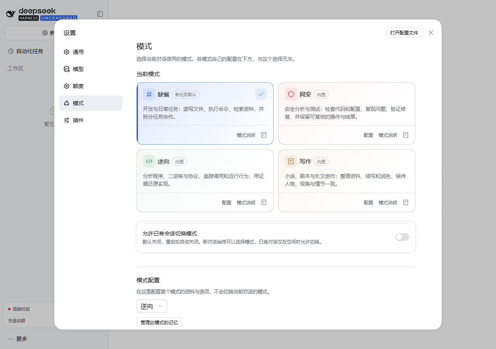

设置 → 模式页集中了四张模式卡片（含“模式说明”和“配置”入口）、**允许已有会话切换模式**开关和各模式的资料配置。切换开关默认关闭、重启后自动关闭，打开前需要阅读倒计时确认。**敏感操作需要确认**（设置 → 通用）默认开启，统一管理进入网安和切换模式前的确认弹窗；关闭它同样要经过十秒倒计时。

## 通用增强

### 旁问与随问

主线负责推进任务，旁问用来连续讨论，随问用来临时确认。两者都不会把主线复制成侧栏里的普通会话，也不会打断正在运行的主线。

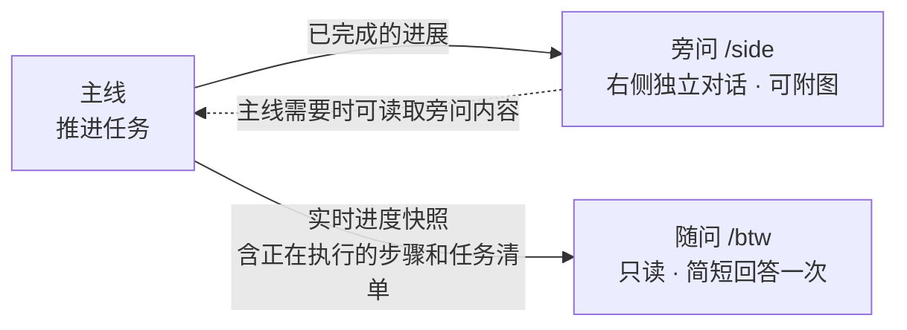

| | 主线 | 旁问 `/side` | 随问 `/btw` |
| --- | --- | --- | --- |
| 看到的主线内容 | 全部历史 | 最近一个完成回合为止的进展 | 实时进度，包括尚未结束的步骤 |
| 权限 | 会话权限 | 继承主线的模型、权限与沙盒 | 固定为只读 |
| 历史 | 保留 | 独立保留，关闭后可继续 | 每次新建，新的随问替换旧卡片 |
| 显示位置 | 主对话区 | 右侧标签页 | 输入框上方的卡片 |
| 适合 | 推进任务、提出新要求 | 连续追问、讨论方案、附图提问 | “进度如何”、一个小问题 |

#### 旁问 /side

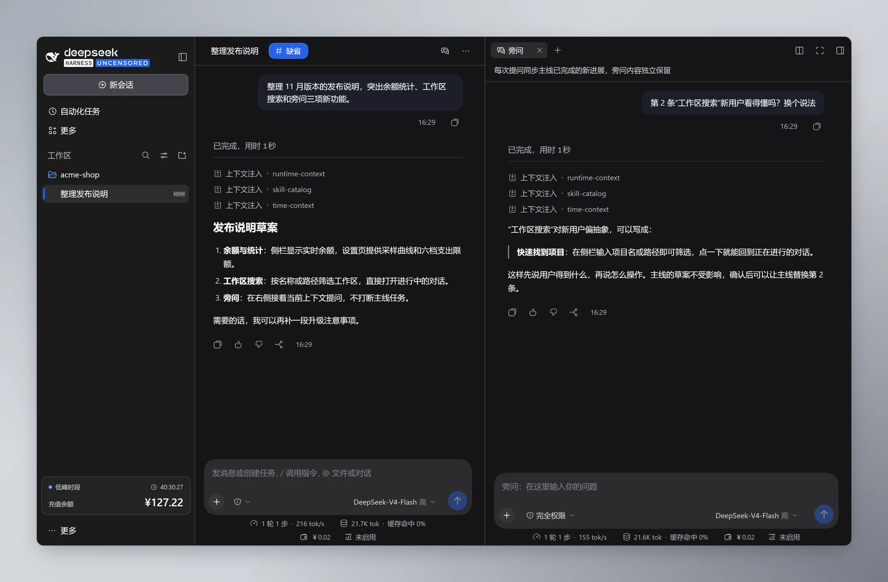

- 输入 `/side 问题` 打开右侧旁问并直接发送；只输入 `/side` 则打开或重开旁问标签。也可以点会话顶部的旁问按钮，或右侧开始页的“旁问”。
- 每次提问前，旁问都会同步主线**已完成**的新进展，自己的对话独立保存。截图里主线已写好发布说明，旁问据此讨论第 2 条的写法，主线草案不受影响。
- 支持附图：在 `/side` 命令或旁问输入框中添加、粘贴图片。能否识别取决于当前模型是否支持图像输入。
- 在旁问中发送 `/clear` 开始全新的旁问，主线历史不变，新旁问仍会读取主线背景。关闭标签默认保留历史；设置 → 通用中的“旁问关闭后自动清除上下文”可改为关闭即清理。

> [!NOTE]
>
> 在旁问里讨论某个操作，不等于向主线下达了执行指令。确认后，需要回到主输入框让主线去做。

#### 随问 /btw


主线正在升级依赖、尚未结束时，输入 `/btw 进度如何`，输入框上方立即出现随问卡片。截图中的回答来自主线的**实时进度快照**：任务清单显示第 2 项“升级并修复失败的测试”进行中，最近一步刚读完 `tests/search.test.mjs`，变更说明还没开始写。主线的计时器和停止按钮仍在运行，没有被打断。

- **能看到什么**：主线当前是运行还是空闲、最近一次用户请求、最新的任务清单，以及最近的消息与工具调用记录（包括还没有返回结果的工具调用）。
- **能做什么**：随问固定为只读权限，只回答问题，不会修改文件或执行命令；回答长度默认上限 512 token，思考等级默认“低”，可在设置 → 通用中的“随问思考等级”调整。
- **怎样显示**：每次 `/btw` 新建一个随问，新的卡片替换旧卡片，点 <kbd>×</kbd> 关闭。随问不会出现在侧栏，删除主会话时一并删除。
- **适合问什么**：“进度如何”“刚才那个报错是什么意思”“这个文件改了吗”这类一句话问题。需要连续讨论时改用旁问。

#### 输入预测

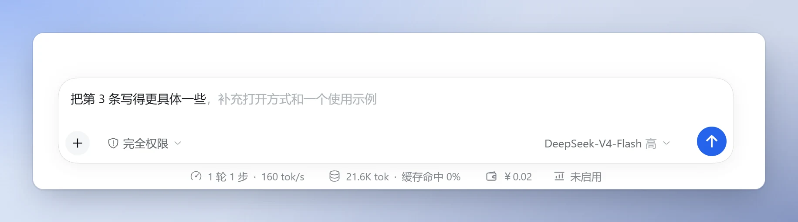

停止输入约 0.8 秒后，输入框会以灰色文字给出续写建议；按 <kbd>Tab</kbd> 填入，是否发送仍由你决定。主线、旁问和随问草稿分别预测。以句末标点结尾、正在输入其他斜杠命令、命令菜单打开时不会触发。预测调用当前模型并计费，默认开启，可在设置 → 通用中关闭。

### 余额与支出限额


- **侧栏余额卡片**：显示充值余额（有赠金时另列），以及当前处于官网的**高峰时段**还是**低峰时段**、距下次切换的倒计时。高峰为工作日北京时间 09:00–12:00、14:00–18:00，周末和法定节假日按低峰计。
- **采样曲线**：默认每 15 秒采样一次，最短 3 秒，可随时刷新。公开 API 不提供历史余额，曲线从本机第一次采样开始累积。悬停、轻触或聚焦后用方向键可读出每个采样点的时间和金额。
- **压缩平稳时段**：余额连续 30 分钟以上不变的区间以横向虚线压缩，合计最多占横轴的五分之一；充值等余额上升以竖向虚线标出。

<table>
<tr>
<td width="50%" valign="top"></td>
<td width="50%" valign="top">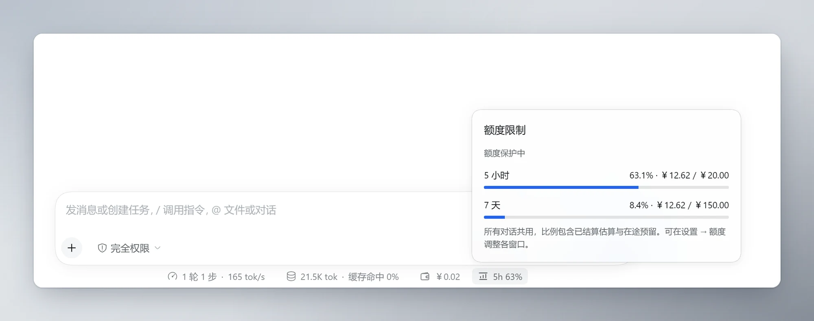</td>
</tr>
<tr>
<td valign="top"><b>六档窗口</b>：15 分钟、1 小时、5 小时、1 天、7 天、30 天，每档独立启停、设定金额和重置，默认全部关闭。所有会话与本机进程共用额度。</td>
<td valign="top"><b>底栏状态</b>：点开金额查看本对话的累计费用曲线，点开“5h 63%”查看各已启用窗口的进度。比例包含已结算估算与在途预留。</td>
</tr>
</table>

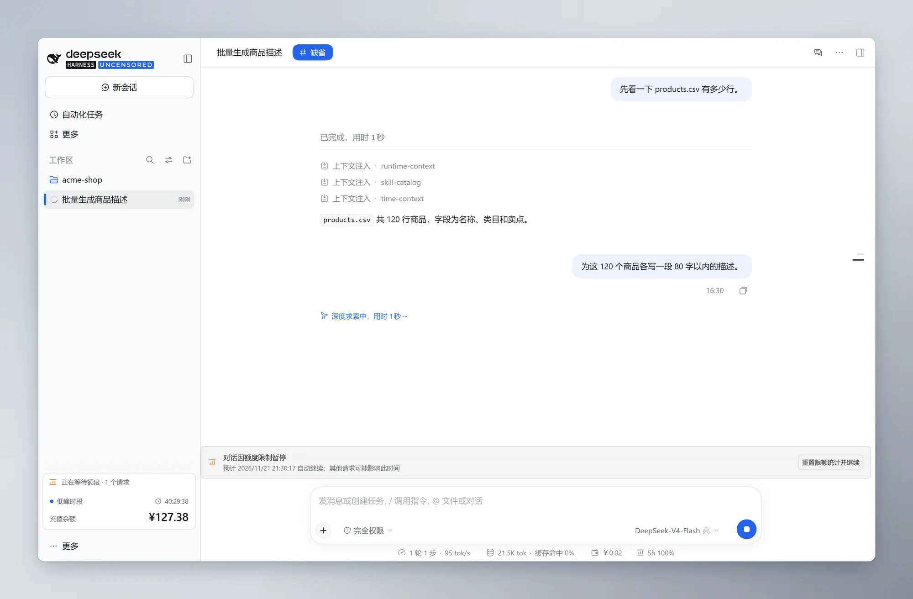

每次请求执行前先按最坏情况预留费用，返回用量后按实际结算，所以进行中的请求会暂时占用额度。达到限额时，对话暂停并在输入框上方显示原因和预计恢复时间，侧栏同步显示“正在等待额度”。开启**自动恢复**后，窗口滚动、额度回到可用范围即自动继续；也可以点“重置限额统计并继续”。

> [!CAUTION]
>
> 重置只清零本地限额统计，不会充值，也不会撤销提供方已经收取的费用。余额曲线、对话费用和限额都是本地估算，不是提供方的正式账单。

### 跨对话记忆

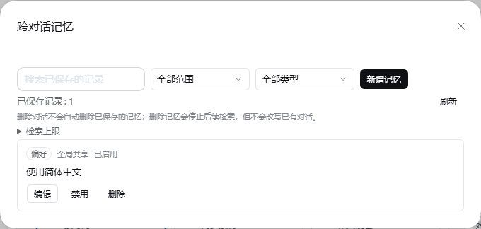

- **四种类型**：偏好、项目事实、操作结论、写作设定。每条记录标明作用范围：全局共享，或限定到某个工作区、某种模式，或两者同时限定。
- **管理**：设置 → 通用 → 管理记忆。可以搜索、按范围和类型筛选、新增、编辑、禁用和删除。各模式的配置页也有“管理此模式的记忆”入口。
- **自动提炼**：默认关闭。开启后，每个回合完成时用当前模型整理长期事实，保存在当前工作区与模式下，提炼会计费并受额度限制。
- **来源**：网安案件备注可以在审阅后“存入记忆”；删除对话不会删除已保存的记忆，删除记忆也不会改写已有对话。

### 会话与工作区

<table>
<tr>
<td width="50%" valign="top"></td>
<td width="50%" valign="top">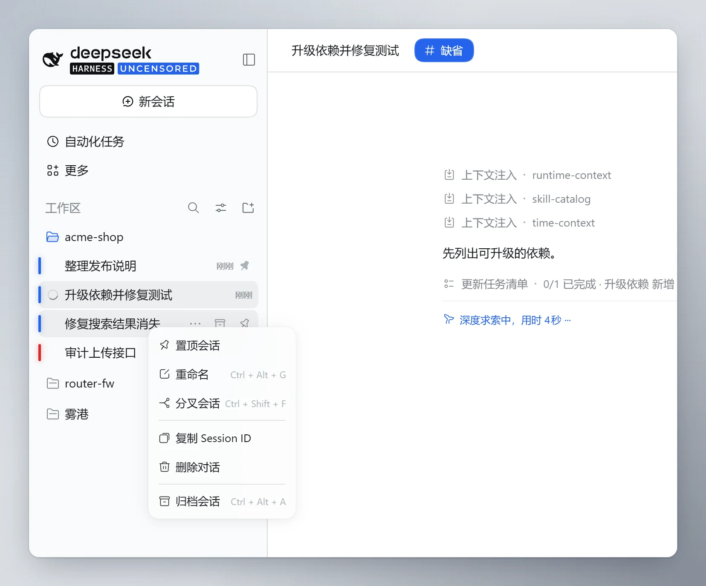</td>
</tr>
</table>

- **模式色条**：侧栏每个会话左侧的竖条标出模式（蓝缺省、红网安、绿逆向、金写作），一眼就能分清手头是哪类任务。运行中的会话显示加载图标，置顶会话带图钉。
- **工作区**：按名称或路径搜索，从项目行直接打开进行中的对话；也可以不在工作区工作。
- **会话菜单**：置顶、重命名、分叉（从会话或某条消息起新建独立分支，继承模式）、复制 Session ID、归档、删除。置顶与普通会话分区拖动排序。


**删除对话**会先停止运行中的任务，再永久删除该会话及其旁问、随问和子会话；工作区文件和独立的分叉不受影响，跨对话记忆需要单独管理。只是想从列表中隐藏，请用归档。

### 外观、关于与更新

<table>
<tr>
<td width="50%" valign="top"></td>
<td width="50%" valign="top">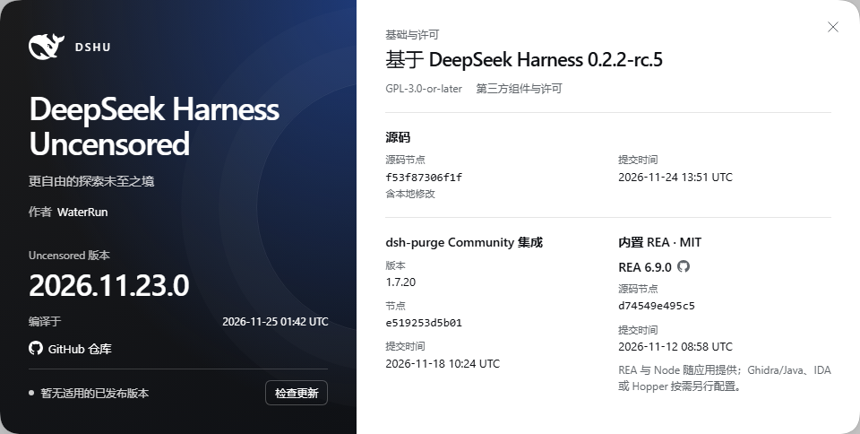</td>
</tr>
<tr>
<td valign="top"><b>外观</b>：新安装默认“日出日落”，按时区对应的代表城市估算日出日落时间，白天浅色、夜间深色；也可选跟随系统、始终浅色或始终深色。模式主题色作用于选中、焦点、模式标记和主按钮。</td>
<td valign="top"><b>关于</b>：账号菜单 → 关于。显示 DSHU 版本与编译时间、所基于的 DSH 版本、源码节点与是否含本地修改、dsh-purge 来源和内置 REA 版本，并可检查 GitHub 更新。账号菜单另有“提交 Issue”入口。</td>
</tr>
</table>

## 安装与数据

| 项目 | 说明 |
| --- | --- |
| 下载 | [预发布 2026.11.17.5](https://github.com/Water-Run/deepseek-harness-uncensored/releases/tag/v2026.11.17.5)：Windows x64 为首发交付，Linux x64 提供检查包 |
| 版本号 | `YYYY.MM.DD.N`，末位是当天的构建序号；在“关于”页核对版本和提交 |
| 数据目录 | 默认 `~/.dsh-uncensored`，可用环境变量 `DSH_UNCENSORED_HOME` 改写 |
| 与官方版并存 | 程序标识、配置、会话和更新渠道相互独立 |
| 首次配置 | 设置 → 模型中填写提供方与凭据，详见[模型配置](docs/user/guide/providers.zh.md) |

> [!IMPORTANT]
>
> 更新前请关闭 DSHU，并备份数据目录和重要的工作区文件。正式签名、在线升级和自动回退尚未完成发行验收，当前状态见[开发清单](.agents/TODO.md)。

## 文档导航

| 文档 | 内容 |
| --- | --- |
| [使用手册](docs/user/guide/dshu.md) | 第一个任务、各模式用法、默认值、数据恢复、故障排查和完整的功能入口表 |
| [模型配置](docs/user/guide/providers.zh.md) | 模型提供方、凭据与自定义接口 |
| [模式资料](packages/client/ui-mode-materials/README.zh.md) · [REA 接入](packages/mcp/rea/README.zh.md) · [执行保护](packages/guard/target-protection/README.zh.md) | 各专项功能的技术说明 |
| [开发清单](.agents/TODO.md) · [交付记录](.agents/HANDOFF.md) | 功能进度、验收状态与发布流程 |
| [反馈问题](https://github.com/Water-Run/deepseek-harness-uncensored/issues/new/choose) | 提交缺陷报告或功能建议 |

## 版本基线

| 组成 | 基线 |
| --- | --- |
| DSHU | 最新公开预发布 `2026.11.17.5` |
| DeepSeek Harness | 源码基于 [0.2.2-rc.5](https://github.com/deepseek-ai/deepseek-harness/releases/tag/dsh-v0.2.2-rc.5) |
| 破甲提示词 | dsh-purge 的 [MIT 历史版本 e1d8e590](https://github.com/Water-Run/dsh-purge/tree/e1d8e59087857fa86d0ef2bb9878800274b13a29) |
| REA | [6.9.0 · d74549e495c5](https://github.com/morluto/rea/commit/d74549e495c58eb4a560279fd9f05508401ea0a0) |

## Credit

- **DeepSeek**：提供原始的 DeepSeek Harness 和鲸鱼轮廓，DSHU 图标在此基础上改为黑底。上游代码保留 [MIT 许可](LICENSES/deepseek-harness-MIT.txt)。
- **小杨（YuJunZhiXue）**：[dsh-purge](https://github.com/YuJunZhiXue/dsh-purge) 提供破甲提示词，DSHU 沿用其 MIT 历史版本并保留[原许可](LICENSES/dsh-purge-MIT.txt)。关于页记录了 [Water-Run/dsh-purge 的对照提交 19082c2b9788](https://github.com/Water-Run/dsh-purge/commit/19082c2b9788039fa7f8888c4a69086f43adc1ff)及其时间。同时感谢 **JeffKeeping** 的 [dsh-purge-plus](https://github.com/JeffKeeping/dsh-purge-plus)。
- **morluto**：维护 [REA](https://github.com/morluto/rea)。DSHU 内置版本保留其 MIT 许可和第三方声明。
- **其他组件**：可选保护使用 [DB-IP Lite](https://db-ip.com/db/download/ip-to-country-lite)（[CC BY 4.0](https://creativecommons.org/licenses/by/4.0/)）以及 [QuickJS](https://bellard.org/quickjs/) / [quickjs-emscripten](https://github.com/justjake/quickjs-emscripten)（[MIT 声明](LICENSES/quickjs-wasm-MIT.txt)）。GitHub 标志来自 [Octicons](https://github.com/primer/octicons)，保留 [MIT 许可](packages/client/ui-settings-account/GITHUB-MARK-LICENSE.txt)。

DSHU 以 [GPL-3.0-or-later](LICENSE) 发布，上游和第三方组件保留各自的许可与署名。
