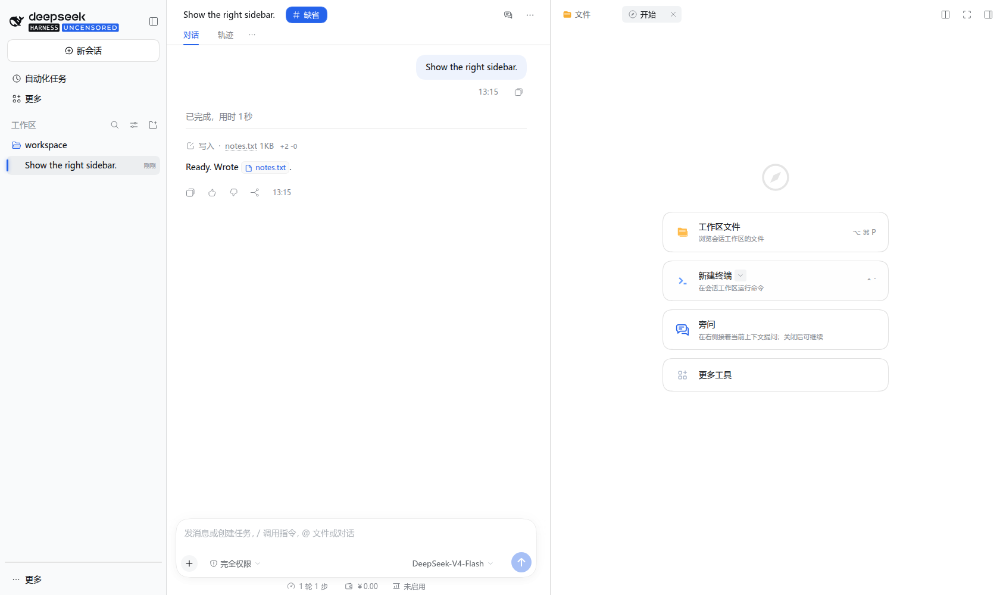

  
  <h1>DeepSeek Harness Uncensored</h1>
  
<b>更自由的探索未至之境</b>

**DeepSeek Harness Uncensored（DSHU）** 是基于 DeepSeek Harness 的桌面智能体工作台。它内置破甲提示词，并为软件开发、网络安全、逆向工程和创作写作分别准备了一种模式。每种模式有自己的主题色、资料目录和工作流程，打开会话就能看出手头是哪一类任务。

模式之外，DSHU 还提供旁问与随问、余额曲线与滚动限额、跨对话记忆和输入预测等通用增强。它使用独立的程序目录、配置、会话和更新渠道，可以与官方 DeepSeek Harness 同时安装，互不干扰。

[四种模式](#四种模式) · [通用增强](#通用增强) · [文档导航](#文档导航) · [版本基线](#版本基线) · [Credit](#credit)

## 四种模式

四种模式共用内置破甲提示词，区别在于专属资料、工作流程和可用工具。主题色会出现在会话顶部的模式指示、侧栏色条和模式指南中。

| 模式 | 主题色 | 适合的任务 | 专属资料 |
| --- | --- | --- | --- |
| 缺省 | 蓝 `#2563EB` | 开发、排错与资料整理 | 当前工作区 |
| 网安 | 红 `#DC2626` | 安全审计、问题复现与修复验证 | `.security/` 案件 |
| 逆向 | 绿 `#15803D` | 程序、二进制与协议分析 | `.reverse/` 案件 |
| 写作 | 金 `#A16207` | 小说、剧本与长文创作 | `story/` 文风与设定 |

新会话默认使用缺省模式，第一条消息发送前可以改选。已有会话的模式默认锁定；确需更换时，可在 **设置 → 模式** 中临时允许空闲会话切换，该许可在重启后失效。

### 缺省 · 开发与日常任务

读写文件、执行命令、检索资料，并把多步任务拆分协作完成。适合修复程序、理解陌生项目和整理资料。

- **工作区**：读取和修改工作区文件，运行构建、测试与日常命令。一般问答可以选择不在工作区工作。
- **检索与协作**：查找资料，按需调用工作流和子任务推进多步工作。
- **交付核对**：修改完成后检查正常与异常输入，并把已运行的验证和仍待确认的事项分开说明。

### 网安 · 调查与证据

检查代码和配置、复现问题、验证修复，并保留可复核的操作与结果。

- **案件记录**：`.security/` 保存目标、证据、发现和备注，可在设置中整理并生成报告。审阅过的案件备注可以存为限定范围的记忆。
- **现场手册**：提供七类现场手册，作为调查与验证的工作流程。手册不会自动安装外部工具。
- **进入确认**：首次进入新的网安会话时，先阅读责任声明和当前保护状态，再确认进入。
- **独立代理**：为受支持的工具流量提供单独的网络出口，对端通常只看到代理出口地址。设置页可以查看、导出脱敏后的流量记录，并开启“未启用代理”的顶部提醒。
- **目标保护**：境内网站、手动目标与生产资源保护默认关闭。按需启用后，设置页会显示各执行器的实际覆盖。

独立代理与目标保护的覆盖范围

- **代理范围**：仅在网安模式中生效，覆盖受控网页抓取、遵守代理变量的命令与终端、桌面侧栏，以及以 `launch` 方式运行的 Playwright MCP、Chrome DevTools MCP 和 Stagehand。
- **流量记录**：不透明的 HTTPS 隧道只记录连接元数据。[进阶目标保护](packages/guard/target-protection/README.zh.md)可以为指定工具启用 HTTP/1.1 检查，并脱敏记录正文。
- **证书信任**：桌面侧栏和三个启动型浏览器各自管理会话信任；命令行客户端可以显式信任监听器的公开证书。
- **保护规则**：境内网站、手动目标和生产资源规则通过[可选保护配置](apps/cli/config/examples/target-protection.yml)接入，默认全部关闭。
- **拦截与审计**：已覆盖的执行后端会在真实执行前拦截并留下审计记录。设置页分别列出 HTTP、本机文件、命令与终端、SSH 和数据库的覆盖情况；SSH 显示已验证的连接，数据库显示已配置的数量，连接和权限在执行时核验。
- **尚未覆盖**：原生入站隔离、其他协议和部分远端资源仍在开发中，开关本身不代表这些场景已受保护。

### 逆向 · 从样本到行为

分析程序、二进制与协议，追踪调用和运行行为，用证据还原实现。

- **样本分析**：记录样本哈希与架构，结合静态与动态分析检查文件格式、符号和调用关系。设置中可查看只读的样本清点。
- **内置 REA**：随 DSHU 提供 REA 6.9.0，无需另装。Ghidra、Java、IDA 等可选引擎按需配置，各自显示状态。[REA 接入说明](packages/mcp/rea/README.zh.md)
- **手册与案件**：提供八类分析手册；`.reverse/` 保存笔记、证据和待验证的结论，后续会话可以接着使用。

### 写作 · 文风与长篇延续

小说、剧本与长文创作：整理资料、续写和润色，保持人物、视角与情节一致。

- **参考文风**：选用参考资料，并用六轴风格卡约定表达方式。
- **设定集**：在 `story/bible/` 管理人物、世界观和时间线。续写时检查视角、人物关系与设定冲突。
- **资料选择**：只有选中的文风与设定会进入模型请求。写作模式不挂载终端和代码执行工具。[写作资料管理](packages/client/ui-mode-materials/README.zh.md)

## 通用增强

### 旁问和随问

- **旁问**：输入 `/side 问题` 打开右侧旁问并发送；只输入 `/side` 则打开或重开。旁问每次提问都会参考主线的最新进展，历史独立保存，并支持附图。
- **清理旁问**：在旁问中发送 `/clear` 清空旁问历史。关闭旁问默认保留历史，也可以在设置中改为关闭时自动清理。
- **随问**：输入 `/btw 问题`，在主会话中得到一条简短回答，侧栏不会新增会话。

### 余额和额度

- **余额曲线**：默认每 15 秒采样一次，最短可设为 3 秒，也可以立即刷新。悬停可查看具体时间和金额，长时间没有变化的区间以虚线压缩显示。
- **六档限额**：从 15 分钟到 30 天共六档窗口，默认全部关闭，每档可以单独设定金额、启停和重置。设置页优先显示 5 小时和 7 天。
- **暂停与恢复**：达到限额时显示暂停横幅、预计恢复时间和快捷重置。开启自动恢复后，额度回到可用范围即继续任务。重置只清零本地统计，不会充值，也不会撤销提供方已收取的费用。
- **底栏用量**：点开本对话费用可查看累计曲线，点开限额状态可查看各窗口的进度。

### 记忆和输入预测

- **跨对话记忆**：按范围检索、编辑、停用或删除结构化记忆。自动提炼默认关闭。
- **输入预测**：默认开启。主线、旁问和随问分别给出建议，按 `Tab` 填入。
- **模型用量**：输入预测和自动提炼都会调用当前模型，按提供方的规则计费。

### 会话和外观

- **工作区**：按名称或路径搜索工作区，从项目行直接打开进行中的会话，也可以不在工作区工作。
- **会话操作**：支持归档、置顶、分叉和删除。任务运行时仍可继续发送消息。
- **主题与布局**：主题色随会话的模式切换，侧栏色条标出每个会话的模式。界面可选浅色、深色、跟随系统或日出日落。

## 文档导航

| 文档 | 内容 |
| --- | --- |
| [使用手册](docs/user/guide/dshu.zh.md) · [English](docs/user/guide/dshu.md) | 首次配置、四种模式的用法、费用与限额、数据恢复和故障排查 |
| [细节功能索引](docs/user/guide/dshu-features.zh.md) | 按入口查找会话、旁问、余额、模式与设置的具体操作 |
| [模型配置](docs/user/guide/providers.zh.md) | 模型提供方、凭据与自定义接口 |
| [预发布下载](https://github.com/Water-Run/deepseek-harness-uncensored/releases/tag/v2026.11.17.5) | Windows x64 与 Linux x64 检查包 |
| [开发清单](.agents/TODO.md) · [交付记录](.agents/HANDOFF.md) · [Windows 首发交接](.agents/requirements/windows-x64-first-release.md) | 功能进度、验收状态、候选回退与手动发布流程 |
| [反馈问题](https://github.com/Water-Run/deepseek-harness-uncensored/issues/new/choose) | 提交缺陷报告或功能建议 |

## 版本基线

| 组成 | 基线 |
| --- | --- |
| DSHU | 日期版本 `YYYY.MM.DD.N`，末位是当天的构建序号；最新公开预发布为 `2026.11.17.5` |
| 平台 | Windows x64 桌面版为首发交付；Linux x64 提供检查包，正式交付安排在后续版本 |
| DeepSeek Harness | 源码基于 [0.2.2-rc.5](https://github.com/deepseek-ai/deepseek-harness/releases/tag/dsh-v0.2.2-rc.5) |
| 破甲提示词 | dsh-purge 的 [MIT 历史版本 e1d8e590](https://github.com/Water-Run/dsh-purge/tree/e1d8e59087857fa86d0ef2bb9878800274b13a29) |
| REA | [6.9.0 · d74549e495c5](https://github.com/morluto/rea/commit/d74549e495c58eb4a560279fd9f05508401ea0a0) |
| 已安装版本 | 在「关于」页核对 DSHU 与 DSH 的版本、编译信息和各依赖的来源 |

## Credit

- **DeepSeek**：提供原始的 DeepSeek Harness 和鲸鱼轮廓，DSHU 图标在此基础上改为黑底。上游代码保留 [MIT 许可](LICENSES/deepseek-harness-MIT.txt)。
- **小杨（YuJunZhiXue）**：[dsh-purge](https://github.com/YuJunZhiXue/dsh-purge) 提供破甲提示词，DSHU 沿用其 MIT 历史版本并保留[原许可](LICENSES/dsh-purge-MIT.txt)。关于页记录了 [Water-Run/dsh-purge 的对照提交 19082c2b9788](https://github.com/Water-Run/dsh-purge/commit/19082c2b9788039fa7f8888c4a69086f43adc1ff)及其时间。同时感谢 **JeffKeeping** 的 [dsh-purge-plus](https://github.com/JeffKeeping/dsh-purge-plus)。
- **morluto**：维护 [REA](https://github.com/morluto/rea)。DSHU 内置版本保留其 MIT 许可和第三方声明。
- **其他组件**：可选保护使用 [DB-IP Lite](https://db-ip.com/db/download/ip-to-country-lite)（[CC BY 4.0](https://creativecommons.org/licenses/by/4.0/)）以及 [QuickJS](https://bellard.org/quickjs/) / [quickjs-emscripten](https://github.com/justjake/quickjs-emscripten)（[MIT 声明](LICENSES/quickjs-wasm-MIT.txt)）。GitHub 标志来自 [Octicons](https://github.com/primer/octicons)，保留 [MIT 许可](packages/client/ui-settings-account/GITHUB-MARK-LICENSE.txt)。

DSHU 以 [GPL-3.0-or-later](LICENSE) 发布，上游和第三方组件保留各自的许可与署名。
